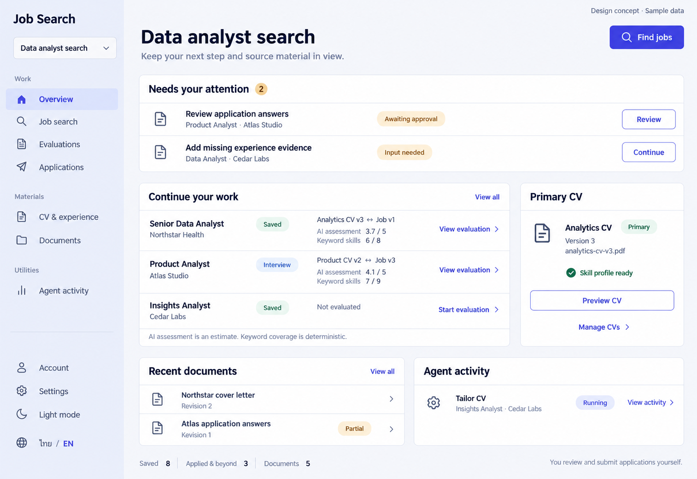

# 01 — Overview / Dashboard design handoff

Date: 2026-10-16 (Asia/Bangkok). Version: v1.

**Status: owner-approved v1 on 2026-10-16. Implementation has not been requested in this image-design round.**

This file is a visual and behavioral handoff for Claude Code. No frontend or backend code was changed to create it. The owner approved this visual reference; application changes remain a separate Claude Code implementation task.

[All-page checklist](CODEX_PAGE_DESIGN_CHECKLIST.md)

## Visual reference

- Image: `docs/codex_gen_page/01-overview-desktop-light-v1.png`.
- Actual raster dimensions: **1513 × 1040 px**. The generation request described a 1600 × 1100 composition; use the actual raster as the reference, not an assumed output size.
- Generated with the built-in ImageGen tool; English UI, desktop, light theme, synthetic content.
- This is an AI-generated design concept, **not a screenshot of a working implementation**.
- Mobile, dark-theme and Thai image references have not been generated in this round. Requirements below describe the intended adaptation; they are not image-verified.

## Workspace and implementation boundary

Current working source:

`/Users/parksurakiat/.codex/worktrees/ux-redesign-plan/AI-Job-Search-Agent-Platform-dem`

Branch: `feat/ux-core-workspaces`. Existing changes are uncommitted. Preserve them; do not reset, overwrite or recreate the existing redesign. The main checkout at `/Users/parksurakiat/AI-Job-Search-Agent-Platform-dem` is a different working tree.

Read root/feature AGENTS instructions, `PRODUCT.md`, `DESIGN.md`, this specification and the existing Overview source before implementing. Keep the existing React, Vite, TypeScript, Tailwind, Radix, i18next and REST/API architecture. Do not implement other pages as part of this page handoff.

## Purpose and hierarchy

The user should understand, in a few seconds:

1. Which project they are in.
2. What requires their input or approval.
3. Which opportunity they can continue working on.
4. Which CV and job revisions produced an evaluation.
5. Whether an agent is still working, and where its result can be reviewed.

This is a working dashboard. Primary actions and source material lead; compact totals support them. Avoid decorative metric-card grids, charts, invented performance trends or hiring-probability claims.

## Page anatomy and UI components

Component names below describe responsibilities. They are **not instructions to introduce a new component library or one file per visual region**. Reuse the existing components first.

| Region | Purpose / contents | Existing components to reuse | Behavior |
|---|---|---|---|
| Project rail | Product identity, current project, task navigation, account/settings, appearance and language | `AppShell`, `ProjectSidebar`, project switcher, `AppearanceControl`, `LanguageSwitch` | Overview is selected using `aria-current`. Switching projects changes the entire resource scope. Keep all current navigation destinations. |
| Page header | Current project name, short orientation copy, Find jobs action | Existing page-header layout, `Button`, router `Link` | Find jobs opens this project's Search. No greeting, avatar, decorative date or extra KPI section is required. |
| Needs your attention | Actionable runs needing input/approval plus unconsumed pending approvals | Existing attention logic, `StatusBadge`, `Badge`, links | Show the actual operation/context and explicit status. Review/Continue opens the session or approval view; it does not approve or submit from this overview. |
| Continue your work | Opportunity list with title, company, stage, paired revisions, AI score and keyword coverage | `StatusBadge`, `SkillCount`, `NewSessionButton`, `JobRemoveMenu`, `latestEvaluations` | A job opens Job Detail. An evaluated row links to its evaluation session. An unevaluated row opens the existing CV/job selection flow. Preserve removal and recovery, although its menu is omitted from the raster. |
| Primary CV | Current primary named CV, revision, filename and readiness | `CvPreviewButton`, shared buttons and badges | Preview opens the existing authorized file preview; Manage CVs opens Profile. This panel does not redefine the source CV of historical evaluations. |
| Recent documents | Latest document titles/revisions and partial state | Shared file icon, links, `Badge` | Open Document Detail. View all opens Documents. A partial document is not presented as finished. |
| Agent activity | Queued/running work with operation, available job context and written state | `StatusBadge`, existing run-link logic | Open the relevant session; sessionless work goes to the existing Console fallback. No invented progress percentage, token count or ETA. |
| Compact progress footer | Saved count, applied-and-later count, document count, manual-submission reminder | Existing stage definitions and counts | Derive counts from current project data. Pending or failed resources show unavailable/loading states, not fabricated zeroes. |

### Layout

- Continue the approved Collection Index indigo/neutral system. Normative colors remain in `DESIGN.md` and source tokens.
- Desktop rail: approximately 248 px. Main gutters grow from 16 px on narrow screens to 40 px on wide screens.
- Header and attention queue span the available work area.
- At a sufficiently wide content width, use a wide opportunity column and a narrower CV context column. In the existing implementation this split starts at `xl`; preserve a sensible breakpoint rather than forcing two cramped columns at tablet widths.
- The image gives the lower Documents/Activity region a more balanced split. Treat that as a proposal for this page, not a change to the global grid system.
- Use one flat surface with divided rows per list, not one card inside another card for every opportunity.
- A list section's title can sit in its surface header as shown; do not add a duplicate heading outside it.
- Buttons and primary controls retain existing minimum target sizes. Standard buttons/inputs are 44 px; compact controls follow the existing shared system.
- Use 24–28 px page titles, 18–20 px section headings, 16 px reading text and 14 px metadata. The raster's apparent title size is not a new global typography token.

### Theme / styling

| Role | Light theme reference | Dark counterpart |
|---|---|---|
| Workspace background | `#F6F7FB` | `#111522` |
| Main surface | `#FFFFFF` | `#1A2030` |
| Main text | `#17233B` | `#EDF1FA` |
| Secondary text | `#53627A` | `#AEBBD0` |
| Primary action | `#4F46E5` | `#ABA7FF` |
| Project rail | `#E8EBFA` | `#202642` |
| Divider | `#DCE1EB` | `#354057` |

Use existing semantic status tokens and text labels. Saved is normally neutral, Interview informational, approval/input states amber, and verified CV readiness green. Do not copy the raster's exact green Saved badge if that conflicts with the shared status system. Use one Lucide icon family with consistent strokes, not emoji or rasterized icons.

## Behavior and existing data

All endpoints below are existing project-scoped reads under `/api/v1`. They are source references, not new API requests to implement on the backend.

| Data | Existing read | Important use |
|---|---|---|
| Project | `/projects/{projectId}` | Header/project identity. |
| Named CVs | `/projects/{projectId}/cvs` | Primary CV and its latest revision. Preserve existing primary/fallback selection. |
| Jobs | `/projects/{projectId}/jobs` | Current opportunity rows, title/company, revision and recorded stage. |
| Runs | `/projects/{projectId}/runs` | Completed evaluations, attention states and active work. |
| Sessions | `/projects/{projectId}/sessions` | Authoritative immutable CV/job pairing and named revision labels. |
| Approvals | `/projects/{projectId}/approvals` | Pending, unconsumed, unexpired requests. |
| Documents | `/projects/{projectId}/documents` | Titles, latest revision and partial state. |

### Source identity

- Find the completed evaluation for the exact job revision with existing `latestEvaluations` behavior; find the session using that run's session ID.
- Show named CV/version only from the matching immutable session. Verify job identity before showing the pair; never substitute the current primary CV.
- `RunView` does not expose a CV revision field. Do not add an invented client field or backend contract to match the image.
- Show AI score only when present, on the existing **0–5** evaluation scale. It is an estimate, not a hiring chance.
- Show deterministic keyword coverage separately, using actual matched/required skills. Missing coverage means unavailable, not 0%.
- If source metadata fails to load, keep the job/result usable and state that source details are unavailable. Do not guess a version.
- Retain the current row limit (up to six jobs) and document limit (up to four). The raster simply contains fewer synthetic examples.

### Attention and agent states

- Attention includes runs in `needs_input` or `waiting_approval`, plus pending approvals not already represented by those rows. Avoid counting the same request twice.
- A pending approval has no decision, has not been consumed and has not expired. Do not make an expired request appear actionable.
- Actual operation/action labels must come from supported types/localization. The image's “Review application answers” is illustrative business copy, not a new approval action. Current approval actions remain `promote_cv`, `delete_document_revision`, `delete_file` and `submit_application`.
- Active work includes `queued` and `running`. A completed item belongs in the appropriate result/material history, not a permanent running badge.
- Preserve existing focus refresh and 15-second refresh while there is live/attention work. Do not invent an Overview SSE endpoint or replace the session's SSE semantics.
- Project changes must not display or mutate resources from the prior project.

### Actions and destinations

| Action | Destination / behavior |
|---|---|
| Find jobs | `/app/projects/{projectId}/search` |
| Job title | `/app/projects/{projectId}/jobs/{jobId}` |
| View evaluation | `/app/projects/{projectId}/sessions/{sessionId}` |
| Start evaluation | Existing `NewSessionButton` / dialog with the saved job selected; user chooses the exact CV revision. |
| Attention Review / Continue | Matching session, otherwise existing Console approval/run fallback. Retain project ID. |
| Manage CVs / Upload first CV | `/app/projects/{projectId}/profile` |
| Document title | `/app/projects/{projectId}/documents/{documentId}` |
| View all opportunities | `/app/projects/{projectId}/applications` |
| View all documents | `/app/projects/{projectId}/documents` |
| View activity | `/app/projects/{projectId}/console` |

“Applied” remains a tracking record. The user sends real applications themselves. No button in this mock authorizes sending applications, granting agent access or bypassing approvals.

## Canonical bilingual copy

Use i18next, preserve user-authored names/content, and keep UI language separate from generated-document language. Reuse existing keys if their meaning matches.

| English | Thai |
|---|---|
| Overview | ภาพรวม |
| Find jobs | ค้นหางาน |
| Needs your attention | สิ่งที่ต้องดำเนินการ |
| Review | ตรวจสอบ |
| Continue | ทำต่อ |
| Awaiting approval | รออนุมัติ |
| Input needed | ต้องการข้อมูลเพิ่มเติม |
| Continue your work | ทำงานต่อ |
| View all | ดูทั้งหมด |
| View evaluation | ดูผลประเมิน |
| Start evaluation | เริ่มประเมิน |
| Not evaluated | ยังไม่ได้ประเมิน |
| Primary CV | CV หลัก |
| Preview CV | ดูตัวอย่าง CV |
| Manage CVs | จัดการ CV |
| Skill profile ready | ข้อมูลทักษะพร้อมใช้งาน |
| Recent documents | เอกสารล่าสุด |
| Revision 1 | เวอร์ชัน 1 |
| Partial | ยังไม่ครบถ้วน |
| Agent activity | งานของ Agent |
| Running | กำลังทำงาน |
| AI assessment is an estimate. Keyword coverage is deterministic. | ผลประเมิน AI เป็นค่าประมาณ ส่วนความครอบคลุมทักษะคำนวณจากคำสำคัญ |
| You review and submit applications yourself. | คุณเป็นผู้ตรวจสอบและส่งใบสมัครจริงด้วยตัวเอง |

The project name, CV name, job/company names, scores, revisions and counts in the image are synthetic examples. Do not hardcode them into the application.

## States not shown in the main raster

| State | Required presentation |
|---|---|
| First project / no CV | Clear Upload first CV section and an optional Find jobs path. Do not show fake readiness or example opportunities as real content. |
| No jobs | Concise explanation plus Find jobs / Add posting. Preserve the existing manual posting capability. |
| No documents | Explain that evaluated/prepared work can produce documents; no fake document rows. |
| No active agents | “No active tasks” or equivalent localized state. |
| No attention items | Hide the attention queue rather than leaving a large empty warning surface. |
| Loading | Independent region skeletons with localized status; keep stable layout and navigation. |
| Partial resource failure | Scoped error and retry. A failed CV/document read must not erase all usable job rows. |
| CV uploaded but skill profiling pending | Explicit pending/uploaded state; mark ready only when `skill_profile_ready` is true. Missing readiness data is unknown, not success. |
| Needs input / awaiting approval | Written distinction and a contextual continuation action. |
| Partial result / partial document | Written partial badge and access to the available result; never label it complete. |
| Provider unavailable | Honest recovery/setup guidance; retain saved work. No claim that AI always runs locally or never sends CV content outside the device. |
| Long Thai/English content | Wrap important names and revision context; preserve access to the full text and primary actions. |

## Responsive and accessibility handoff

- At tablet widths, reduce gutters and stack the main/context columns before text becomes cramped. Do not shrink a desktop table until unreadable.
- On mobile, keep the existing accessible drawer and language/theme access. Suggested content order: header → attention → first-CV setup when applicable → opportunities → primary CV → recent documents → agent activity → compact totals. If CV setup is required, elevate that action above empty opportunity content.
- Reflow opportunity metadata/actions into a vertical row. Keep job identity, evaluation source and continuation visible without horizontal page scrolling.
- All semantic sections have headings; use one page h1. No content eyebrow above that h1.
- Links navigate; buttons perform actions. Do not use a clickable div for the whole row with nested buttons.
- Provide visible focus, keyboard-operable menus/dialogs, sensible focus return, readable contrast, reduced-motion support and written states independent of color.
- The image is not evidence of keyboard, mobile, Thai, dark-theme or contrast compliance. Claude Code must verify the built page separately.

## Image-to-implementation corrections

These are intentional clarifications, not requests to imitate generation artifacts:

1. The second recent-document metadata line is rendered as **“Kevision 1”**. Canonical text is **“Revision 1”** / **“เวอร์ชัน 1”**.
2. Use flat semantic surfaces. Any subtle background shading/gradient introduced by image generation is not a new design requirement.
3. Use the existing icon and appearance controls. The picture's moon beside “Light mode” is illustrative and must not create an ambiguous theme toggle.
4. The removal/overflow menu is absent in the raster. Preserve the existing job-removal capability and confirmation/recovery behavior.
5. English labels in the image do not waive Thai support. Dark/mobile adaptations are specified but await their own image review if the owner wants them.
6. Copy, source identity, status semantics and API safeguards in this Markdown/product contract take precedence over incidental pixels or synthetic data.

## Claude Code acceptance checklist — after owner approval

- [x] Owner approved Overview v1 on 2026-10-16; implementation remains a separate request.
- [ ] Inspect the existing uncommitted worktree and applicable AGENTS instructions; preserve existing capabilities.
- [ ] Build semantic UI matching the approved hierarchy using current primitives and tokens; do not use the screenshot as the page body.
- [ ] Keep real project-scoped reads, session/run/approval semantics and contextual action routes.
- [ ] Preserve exact CV/job source labels; separate AI estimate from keyword coverage.
- [ ] Handle each empty/loading/error/pending/partial/provider state above.
- [ ] Verify desktop, tablet and mobile; Thai/English; Light/Dark; keyboard and focus.
- [ ] Run frontend build/typecheck and relevant existing/new Playwright journeys using synthetic fixtures. Do not weaken tests.
- [ ] Capture actual browser screenshots and compare them to the approved reference and this specification.
- [ ] Record what was verified versus untested, and update the page checklist separately for design approval and implementation.

This draft generation did not rerun application tests; the prior implementation's test results must not be presented as proof that this new image has been implemented.

## Generation provenance

- Tool: built-in ImageGen, new image generation, opaque background.
- Original generated file retained under the local Codex generated-images directory.
- Original project copy SHA256 before any provenance metadata embedding: `6b6533fe0c7800cb8e90c0a8df11f5b527ae079f9d76cafab240eaa09b2f1391`.
- Input: product/source-derived textual brief, no real CV, account, provider credential or personal data.
- Exact generation prompt follows below so subsequent revisions can preserve or deliberately change the intended hierarchy. It is also embedded in the PNG metadata. The current image SHA256 is `7364dbf108edbbb9e33f8306ae913b8de2a2616087061bd5601cbdb6ccee0d2c`; see `codex_gen_page/manifest.json`.

Use case: ui-mockup. Asset type: a full desktop screen design for an existing bilingual Thai/English productivity web application, AI Job Search Agent Platform. Generate ONE high-fidelity, straight-on, crisp 1600x1100 desktop UI mockup, no device frame, no perspective, no collage, no web page code. This is the first page concept: project Overview. This is an Operate surface: next useful action, source identity, calm information hierarchy. Extend a refined Linear/Teal/Huntr-caliber workspace, not their branding. Aim for a beautiful finished enterprise productivity interface with meticulous alignment and excellent readable text. Use English labels in this image; real product supports Thai separately.

VISUAL SYSTEM: cool neutral background #F6F7FB, white surfaces #FFFFFF, dark navy ink #17233B, secondary text #53627A, indigo #4F46E5 for primary action and selected navigation; pale indigo rail #E8EBFA, fine #DCE1EB dividers, green #166445 and amber #805319 for textual states. Noto Sans Thai / Manrope style clean typography: 28px h1, 18-20px section headings, 14-16px body. Regular generous spacing, 12px panel radius, thin borders, almost no shadows. Single consistent thin-stroke icon family. No gradients, glass, large metric cards, charts, percentages for hiring probability, decorative illustrations, avatars, pill clutter, excessive nesting or pointless animation. No eyebrow or kicker above the h1.

COMPOSITION: fixed 248px left project rail, full-height. Main area has 40px outer gutters, 24-32px spaces. Rail wordmark "Job Search"; project dropdown "Data analyst search". Group Work: Overview (selected), Job search, Evaluations, Applications. Group Materials: CV & experience, Documents. Group Utilities: Agent activity. At bottom Account, Settings, light/dark control, and language switch ไทย / EN. Main top left h1 "Data analyst search", below restrained subtitle "Keep your next step and source material in view." Top right indigo button "Find jobs". Small unobtrusive label "Design concept · Sample data" at top right separate from title.

Immediately below, a broad compact attention queue, flat white surface, heading "Needs your attention" with tiny amber count 2. Two well-aligned rows with title, contextual job and explicit text state, right action. Row1 "Review application answers"; subline "Product Analyst · Atlas Studio"; status "Awaiting approval"; action "Review". Row2 "Add missing experience evidence"; subline "Data Analyst · Cedar Labs"; status "Input needed"; action "Continue". No inline Approve or Submit buttons here; this leads to contextual review.

Below that a two-column workspace ~2.5:1. Wide left column heading "Continue your work" and right-aligned text link "View all". A SINGLE white flat list surface with three rows and horizontal separators, not separate card tiles. Each row has job title/company, a small stage label, precise evaluation source and method; a right-aligned continuation link. Row1 "Senior Data Analyst" / "Northstar Health", stage "Saved"; source "Analytics CV v3 ↔ Job v1"; metrics text "AI assessment 3.7 / 5" and "Keyword skills 6 / 8"; action "View evaluation". Row2 "Product Analyst" / "Atlas Studio", stage "Interview"; source "Product CV v2 ↔ Job v3"; text "AI assessment 4.1 / 5" and "Keyword skills 7 / 9"; action "View evaluation". Row3 "Insights Analyst" / "Cedar Labs", stage "Saved"; text "Not evaluated"; action "Start evaluation". Scores are evaluation estimates, never hiring odds. A quiet shared caption under list "AI assessment is an estimate. Keyword coverage is deterministic." Keep two distinct methods, no giant scores.

Narrow right column heading "Primary CV"; white flat panel showing a file icon, "Analytics CV", small green "Primary", "Version 3", filename "analytics-cv-v3.pdf", textual status "Skill profile ready"; outline button "Preview CV"; text link "Manage CVs". This panel names the current primary CV, but never implies past evaluations update to it.

Lower left heading "Recent documents", right link "View all". Two clean document rows: "Northstar cover letter" · "Revision 2"; "Atlas application answers" · "Revision 1" with amber text badge "Partial". Lower right heading "Agent activity"; one restrained row "Tailor CV" / "Insights Analyst · Cedar Labs", indigo textual state "Running"; link "View activity". Do not invent a percentage or ETA.

Bottom compact inline totals, secondary to tasks: "Saved 8   Applied & beyond 3   Documents 5". Footer note "You review and submit applications yourself." Keep whole screen unclipped and readable. Everything is clearly synthetic illustrative data, not real user activity. Render the exact written interface labels cleanly; do not add features, extra nav items, a chat launcher, graphs, or floating panels. Produce a polished detailed full-page product design image, with adequate space for the lower content.
