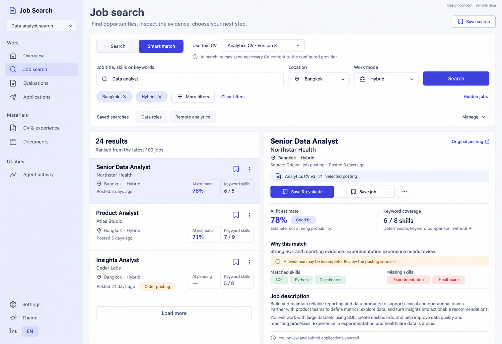

# 02 — Job Search design handoff

Date: 2026-10-16 (Asia/Bangkok). Version: v1. **Owner-approved v1 on 2026-10-16. No application code changed; implementation remains a separate task.**

[Page checklist](CODEX_PAGE_DESIGN_CHECKLIST.md) · [Approved Overview / shared direction](01_OVERVIEW_DESIGN.md)

This is an ImageGen concept with synthetic content, not a working browser screenshot. Desktop/light/English only; mobile, dark and Thai images have not been generated. The image's “Sample data” label describes this design artifact, not the application's sample-search scoring behavior.

## Scope and source

Route: `/app/projects/:projectId/search`. Continue in the existing `feat/ux-core-workspaces` worktree documented in the Overview handoff. Preserve its uncommitted changes. Implement this page only after approval; no backend/API changes or second component system.

Primary source: `frontend/src/features/search/SearchPage.tsx`, `AdvancedFilters.tsx`, `SavedSearches.tsx` and their current filter/preset/highlight helpers. Reuse shared `AppShell`, `ProjectSidebar`, Button/Input/Label/Badge, `CvPreviewButton`, `NewSessionButton`, `Markdown`, existing `BandBadge`, `MatchSummary` and `SaveJobButton` behavior. Component responsibilities below do not require new files.

## Purpose

Search → narrow results → inspect a posting against the selected CV → save or open an evaluation session. Keep evidence, source and uncertainty visible. This is a list/detail workspace, not a metric dashboard or an automated application sender.

## Regions and components

| Region | UI / content | Behavior |
|---|---|---|
| Shared project rail | Same navigation and controls as approved Overview; Job search selected | Preserve project switching, Account, Settings, appearance and TH/EN. Account is accidentally omitted from the image; retain it. |
| Header | Job search title, concise subtitle, Save search button | Save search opens existing named-search creation flow, not Save job. |
| Search mode / CV | Search / Smart match, named CV with exact revision, provider disclosure | General Search does not invent CV scores. Smart match requires the selected revision and preserves current CV profiling/ranking behavior. Keep CV preview accessible even though omitted from the raster. |
| Search form | Query, location, work mode, Search action | Preserve existing URL-backed state, validation and query submission semantics. |
| Filter controls | Removable active chips, More filters, Clear filters, Hidden jobs | Advanced filters progressively reveal current supported controls; clearing or switching modes follows existing filter-state helpers. |
| Saved searches | Compact saved-search shortcuts and management disclosure | Applying a saved search restores its actual filters. Retain name, delete, frequency, digest, push/webhook, Telegram and preview features with their existing eligibility rules. |
| Result list | Actual count/pool context, divided rows, selected state, bookmark, menu and Load more | Selecting changes the inspector; saving/hiding must not accidentally open a different job. Keep existing deduplication, pagination and ordering. |
| Selected posting | Title/company/location, posting age, original source, CV context | Only show available metadata. External source uses existing safe HTTP(S) validation and opens independently. Unsaved search postings have no invented saved-job revision number. |
| Primary actions | Save & evaluate, Save job, hide menu | Evaluation opens existing `NewSessionButton` with the inline posting; user confirms the exact CV/job pair. Saving uses current job POST and duplicate handling. No Apply/auto-submit button. |
| Match evidence | AI fit estimate and deterministic keyword coverage, distinct explanations, matched/missing skills | Preserve null/partial/unavailable/uncertain states. Search AI percent is not the later evaluation's 0–5 score. |
| Description | Readable posting text/highlights and manual-submission reminder | Use current safe Markdown/highlight rendering. Never execute posting HTML or infer permissions from its content. |

## Match semantics — normative

- AI result uses existing `ai_match.fit_percent`, `band`, `uncertain`, `hard_blocker`, `seniority`, `skills_evidenced`, `must_missing` and `nice_missing`. It is **not a hiring probability**.
- Keyword coverage uses actual `match.matched`, `required_count`, `missing` and `score_percent`. It is deterministic and is not an ATS pass guarantee.
- “Why this match” in the raster is illustrative copy. The current result type has no free-form rationale field. Use supported structured evidence and existing localized summaries; do not invent an explanation property, extra AI call or backend endpoint.
- Render uncertainty/blocker warnings from real fields. The sample uncertainty callout is not mandatory for every confident result, and a real uncertain result must not look definitive.
- The image shows a subset of skill chips. In implementation, show all relevant supported evidence or explicitly indicate remaining items; do not imply three chips account for six matched skills without explanation.
- Pending/unavailable AI leaves keyword coverage usable. Unknown scores display unavailable/pending, never fabricated 0%.
- Existing application sample mode does not compute Smart match; preserve its honest sample/no-scores behavior. Do not hardcode the illustration's scores into it.

## Existing data and state

All REST paths are existing reads/actions beneath `/api/v1`; reuse current request builders and exact body contracts.

| Resource | Existing endpoint / responsibility |
|---|---|
| General results / facets | `/projects/{projectId}/job-search` and `/job-search/facets` |
| CVs | `/projects/{projectId}/cvs`; selected immutable revision drives Smart match |
| Ranked results / ranking run | `/projects/{projectId}/job-search/match`; POST `/job-search/match/runs`, with existing run polling/cancellation/stale-request guards |
| Saved jobs | `/projects/{projectId}/jobs`; existing GET/POST and source/title-company duplicate detection |
| Hidden jobs | `/projects/{projectId}/job-search/hidden`; preserve current list/hide/restore methods and payloads |
| Saved searches | `/projects/{projectId}/saved-searches`; existing CRUD/update/preview behavior |

Keep query/filter state in the URL, including supported `mode`, `q`, `cities`, `work_mode`, `posted_within_days`, `category`, seniority, employment type, company type, skills, posting language and minimum salary. Preserve current serialization and mode-specific support; a prettier location control must not introduce an unsupported general-search filter. Reset pagination/selection and cancel stale work as existing logic requires. Respect available source facets rather than inventing filter options.

Current source uses 20-item general pages and a Smart match pool of 100. The “24 results” and ranking-pool text in the image are examples: derive counts from the response/current pool, distinguish partial AI coverage, and never imply every job in the market was ranked. Keep current best-match ordering, older-posting flags and source transparency. Do not add unsupported multiselect comparison trays; list/inspector selection already supports comparing opportunities sequentially.

Save & evaluate preserves the existing inline-job/session creation flow. It is not an instruction to independently POST a job and then blindly create a session, which risks duplicate or uncertain-result writes. Preserve current error recovery, exact revision selection and idempotency semantics.

## Required states

| State | Presentation |
|---|---|
| No CV in Smart match | Explain dependency, link to project Profile; general Search remains available. |
| CV profiling / ranking pending | Written pending state; retain existing results/keyword data when valid. Do not fake progress or ETA. |
| AI partial / unavailable | Distinguish partial pool coverage and keyword-only results; actionable recovery without erasing usable data. |
| No results | Explain current filters; offer Clear filters or edit query. |
| Source/API failure | Scoped error + Retry; retain filters. Demo fallback must remain explicitly labelled. |
| Loading more | Keep existing rows/selection; show progress on Load more and avoid duplicate rows. |
| Saved / save failure | Clear Saved/open-existing-job state; preserve retry and avoid duplicate jobs. |
| Hidden jobs | Existing hide/restore view; accurate hidden count and recovery. |
| Missing/unsafe source URL | State source unavailable; no unsafe external link. |
| Missing salary/location/age | Show unavailable or omit appropriately; do not invent values. |
| Saved-search notification restrictions | Preserve account verification and webhook/Telegram configuration requirements. |

## Layout, language and accessibility

Use approved Overview/DESIGN semantic tokens and typography. The raster is a composition reference: any generated gradients/shading, tiny controls or logo variations are not new design requirements. Maintain flat surfaces, restrained indigo selection, written statuses and shared Lucide icons. Avoid colored side stripes, nested cards and hiring-probability graphics.

Desktop: one toolbar above a roughly 43/57 result/inspector split. Tablet: collapse before either region becomes cramped. Mobile: result list → selected full-width detail with a clear Back to results action; preserve query, filters, selection and scroll context. Avoid page-wide horizontal overflow. Advanced filters and saved-search management must remain reachable without filling the initial screen.

Use actual form labels, semantic links/buttons, visible focus, keyboard-operable selection/disclosures/menus, reliable dialog focus return, readable Thai wrapping and Light/Dark parity. UI language does not translate job content or change the document output language.

| EN | TH |
|---|---|
| Job search / Search | ค้นหางาน / ค้นหา |
| Smart match / Use this CV | Smart match / ใช้ CV นี้ |
| Location / Work mode | พื้นที่ / รูปแบบการทำงาน |
| More filters / Clear filters | ตัวกรองเพิ่มเติม / ล้างตัวกรอง |
| Saved searches / Save search | การค้นหาที่บันทึก / บันทึกการค้นหา |
| Hidden jobs / Load more | งานที่ซ่อน / โหลดเพิ่ม |
| Save job / Saved | บันทึกงาน / บันทึกแล้ว |
| Save & evaluate | บันทึกและเริ่มประเมิน |
| Original posting | ประกาศต้นฉบับ |
| AI fit estimate / Keyword coverage | ค่าประมาณความเหมาะสมจาก AI / ความครอบคลุมทักษะจากคำสำคัญ |
| Matched skills / Missing skills | ทักษะที่ตรง / ทักษะที่ยังขาด |
| AI pending / Older posting | รอผล AI / ประกาศเก่า |
| Back to results | กลับไปผลการค้นหา |

Reuse existing locale keys when equivalent. The AI/provider disclosure and manual-submission reminder must remain clear in both languages.

## Handoff gates

- [ ] Owner approves Job Search v1 or requests revisions.
- [ ] Claude Code preserves existing uncommitted work and shared components.
- [ ] Real search/filter/URL restore, save/dedup, inline-job evaluation, saved searches and hide/restore journeys work.
- [ ] Source/CV identity, AI uncertainty and deterministic skills remain distinct.
- [ ] Missing/loading/error/partial/provider states, mobile/tablet, TH/EN, Light/Dark and keyboard/focus verified in the actual implementation.
- [ ] Frontend build/typecheck and relevant Playwright regressions pass; actual browser screenshots compared with the approved reference. No weakening tests.

No implementation tests were run for this image draft. Prior frontend passing results do not prove this mock has been implemented.

## Provenance

Built-in ImageGen; synthetic English desktop/light concept. Exact prompt embedded in the PNG. Image metadata and SHA256 are recorded in `codex_gen_page/02-job-search-manifest.json`. Original generated output retained. No real CVs, accounts or credentials used. Additional image variants are not generated yet.
