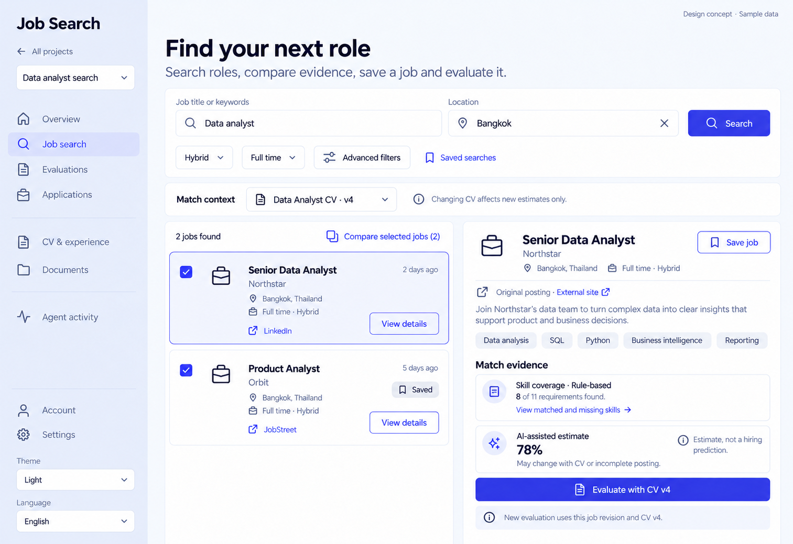

# 02 — Job Search Workspace · v3

Date: 2026-10-17 (Asia/Bangkok). **Review-led new concept; awaiting owner approval. Not implemented. Target10/10 is a quality goal, not an achieved score.**

[Current checklist](CODEX_PAGE_DESIGN_CHECKLIST.md) · [Round2 index and visual contract](CODEX_ALL_PAGES_REDESIGN_V2.md) · [Motion/pixel art specification](CODEX_PIXEL_MOTION_V2.md) · [Previous functional handoff](02_JOB_SEARCH_DESIGN.md)

Synthetic English desktop/light static concept. State pictured: **Results with explicit CV context**. This is not a working website or an animated asset. Other variants/states remain required; this image does not prove mobile, dark, Thai, accessibility or end-to-end behavior.

## Visual and first-user intent

Job search selected. Header Find your next role, subtitle Search roles, compare evidence, save a job and evaluate it. Search query Data analyst and location Bangkok fields in one clearly labeled bar, primary Search. Under bar CV for match context [Data Analyst CV · v4 dropdown], helper Changing CV affects new estimates only. Filters Hybrid, Full time, Advanced filters, Saved searches text link. Results and inspector two-column layout. Left two opportunity rows Northstar Senior Data Analyst and Orbit Product Analyst; both show location, source badge and View details. Selected Northstar highlighted with neutral Saved tracking badge, not green success. Right detail inspector readable title/company, source Original posting · External site link, tags. Two explicitly separate evidence groups: Skill coverage · Rule-based, 8 of11 requirements found, View matched and missing skills; AI-assisted estimate,78%, May change with CV or incomplete posting; help Estimate, not a hiring prediction. One primary Evaluate with CV v4, secondary Save job only if unsaved; selected sample currently UNSAVED so show Save job and no Saved badge on selected row (other row Saved). Notes New evaluation uses this job revision and CV v4. Compact compare action Compare selected jobs (2) only as local comparison proposal, not new backend capability. No score ring, no CV auto-switch ambiguity or fake confidence interval.

Use this composition and corrected copy for the new concept; source `DESIGN.md` remains the shipped UI authority. Flat semantic tokens and shared primitives win over accidental raster gradients, font/glyph inconsistencies or unsupported controls introduced by image generation. Standardize text-only wordmark, shared rail/header, action hierarchy and theme/language controls across every page.

## Functional scope and contracts — retained

The [previous handoff](02_JOB_SEARCH_DESIGN.md) retains this page's route, source files, API/schema details, all secondary tabs, forms, validation, drafts, error/retry, permission and asynchronous states. Read it before implementation. The new visual layout does not remove any of those capabilities. Earlier PNGs remain history, not the current visual target.

Use the existing React/Vite app and existing components, resource/API helpers and i18n. Never add a backend endpoint, change session/run/SSE/approval semantics, use the current primary CV as fallback provenance, or invent data fields to match a generated image. Any new grouping/selection presentation is frontend-only and must preserve supported URL state and project/account security boundaries.

Preserve source-authoritative upload/download behavior, immutable CV/job/document identities, partial documents, confirmations, busy/error recovery and keyboard navigation. Tracking updates never send applications. Authentication/consent/deletion retain existing credential, expiry, capability and safe-redirect rules. Original CV uploads and generated tailored documents are distinct resources.

## Motion specification — explanation only, no code

Search feedback and selection change after real response with150–200ms opacity. No animated AI score. Filters disclose160ms and respect reduced motion.

Animations are specified for Claude Code to implement later. Real operations alone drive progress/status; no timer invents progress or completion. Respect reduced motion, pause decorative motion when the tab is hidden, and avoid moving focused controls. No new animation library is required by this handoff. Use the shared [motion contract](CODEX_PIXEL_MOTION_V2.md) for durations, accessibility and performance limits.

## Pixel art and asset treatment

No pixel art in this page’s main workflow. Keep the shared outline icon family; do not add a mascot or animation behind forms, consent or destructive actions.

## Responsive, bilingual and state requirements

Follow shared requirements from [round1](CODEX_PAGES_07_16_HANDOFF.md) and [round2](CODEX_ALL_PAGES_REDESIGN_V2.md). Reuse the previous bilingual labels, correcting translations for any revised wording so Thai and English mean the same thing. Keep generated-document language separate from interface locale. Desktop columns collapse at tablet; mobile is one column with accessible navigation, wrapping actions, long-text handling and no page overflow. Never hide necessary decisions on mobile.

For new/empty users give a real next action without fake data. Preserve loaded content on partial resource failure; show contextual retry. Existing forms retain drafts on recoverable failure, prevent duplicate writes and announce outcomes. Never show success before server success, running while waiting for a person, or active access after expiry. Show unavailable provenance explicitly rather than guessing.

## Acceptance before implementation completion

Use synthetic fixtures with a frozen clock and coherent dates/statuses. Verify this page's main task plus all relevant pending, approval, partial, empty, invalid-token, permission and failure paths from the previous handoff. Build/type check and run relevant existing/new Playwright tests after actual code changes; inspect real desktop/tablet/mobile, Thai/English and light/dark screenshots, keyboard/focus and reduced-motion behavior. Impeccable review must distinguish concept review from runtime proof. No such implementation results are claimed in this image-only round.
