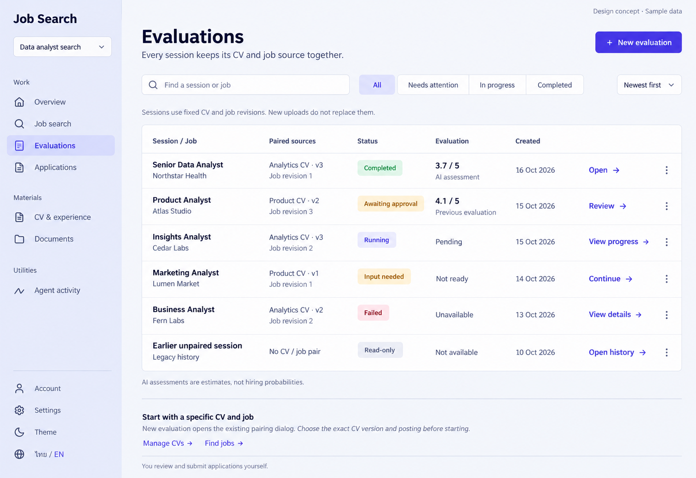

# 03 — Evaluation Sessions index

Date: 2026-10-16 (Asia/Bangkok). Version: v1. **Owner-approved v1 on 2026-10-16. No application code changed; implementation remains separate.**

[Checklist](CODEX_PAGE_DESIGN_CHECKLIST.md) · [Shared visual system and worktree boundary](01_OVERVIEW_DESIGN.md)

ImageGen concept, synthetic content, desktop/light/English. Not a browser screenshot or an implemented feature. Mobile/dark/Thai images have not been generated. Apply only after approval, in the existing `feat/ux-core-workspaces` worktree; preserve its uncommitted work.

## Purpose

Help the user find a previous evaluation, identify its exact CV/job sources and continue the right task. This index is distinct from **page 04**, the individual session workspace containing results, agent progress, approvals and documents.

## Components and behavior

| Region | UI / responsibility | Behavior |
|---|---|---|
| Shared rail | Existing project switcher/navigation, Evaluations selected, Account/Settings/theme/TH–EN | Reuse `AppShell` and `ProjectSidebar`; preserve project scope. |
| Header | Evaluations title, short purpose, New evaluation | Reuse `NewSessionButton` and its existing pairing dialog. Choose exact CV revision and job; preserve creation/idempotency/recovery behavior. |
| Session search | Find a session or job input | Proposed frontend filtering over loaded session title/job/company/CV names. This does not imply a new backend search endpoint. |
| Status filters | All, Needs attention, In progress, Completed | Filter the derived display state below, not a nonexistent `SessionView.status` field. Include accessible selected state and keyboard operation. |
| Sort | Newest first | Sort by `SessionView.created_at`; an Oldest first alternative can use the same existing data. Do not invent “last updated” timestamps. |
| Session list | Title/job, exact paired sources, state, available evaluation, created date, contextual link | One divided table/list surface; not a card grid. Whole-row navigation must not swallow menu actions. |
| Row continuation | Open, Review, View progress, Continue, View details, Open history | Navigate to `/app/projects/{projectId}/sessions/{sessionId}`. No inline approval, retry or application submission. |
| Row overflow | Existing session management where supported | Reuse current rename/delete/restore behavior and busy safeguards. If unavailable in this context, omit the menu rather than add nonfunctional options or invent bulk/purge/export actions. |
| Help / footer | Pairing explanation, Manage CVs, Find jobs, manual-submission reminder | Link to this project's Profile/Search. Keep secondary to the list. |

## Existing source and data

Start from `frontend/src/features/sessions/SessionsPage.tsx`, `NewSessionDialog.tsx`, existing `SessionView`/`RunView`/`ApprovalView` types and shared status components. The current index only reads sessions; richer activity/result columns are a **presentation proposal** using existing resources, not already implemented index behavior.

Existing reads beneath `/api/v1`:

- `/projects/{projectId}/sessions`: titles, immutable pair IDs, CV name/revision, job title/company, created date, outdated-CV indicator and optional evaluation-run ID.
- `/projects/{projectId}/runs`: join using `session_id`; operation, status, creation time and evaluation result.
- `/projects/{projectId}/jobs`: resolve the exact `job_revision_id` to its actual revision number. SessionView itself does not contain a job revision number.
- `/projects/{projectId}/approvals`: join through the actual run; only unconsumed, undecided, unexpired requests are actionable.

Reuse these project resources efficiently; do not issue one duplicate request per row or change backend contracts. Preserve navigation if an auxiliary read fails.

### Source and result rules

- Display named CV/version from the immutable session; never substitute today's primary CV. An outdated CV may show “Newer CV available” without changing the pair.
- Resolve the job version by exact ID. If unavailable, state “Job revision unavailable”; do not infer it from another job with the same title or invent v1.
- Use the session's matching completed `evaluate_job` result, respecting `evaluation_run_id` when supplied and validated. Check session/job identity before presenting the result.
- AI evaluation uses the existing **0–5 scale**, not Job Search's AI percentage and not a hiring probability.
- A previous completed evaluation can remain visible while a later preparation run needs approval. Label it **Previous evaluation**, as in the Atlas example. Do not imply the queued/running operation produced that score.
- Never expose another project's session, source, run or approval during project switches.

### Derived display states

SessionView has **no session status field**. Do not add one to the API to reproduce the image. Derive a presentation state from current relevant runs and valid approvals, separately from result availability:

| State | Rule / action |
|---|---|
| Awaiting approval / Input needed | Relevant `waiting_approval` or `needs_input` run, or valid linked approval; Review/Continue opens its session context. Do not lose either distinction if both exist. |
| Queued / Running | Current live `queued`/`running` work; View progress. No invented percentage or ETA. |
| Failed / Interrupted / Cancelled | Preserve the actual current run state and View details. An older failed attempt must not override a later successful/retried run. |
| Completed | Relevant work completed with no current attention/live state. Score availability is still checked separately. |
| Ready / no run | Paired session without run data is not automatically Completed. Distinguish no work from unavailable activity data. |
| Read-only legacy | Missing CV/job pair; allow existing history access, not unsupported evaluation/mutation. |
| Activity unavailable | Run/approval read failed; keep session and source identity visible, show scoped recovery rather than a guessed terminal state. |

Keep a deterministic documented selection of current runs (including timestamps and retry relationships). Preserve pending-input/approval priority without reviving expired requests or old failures. “Completed” filter refers to the derived current activity state; having an old score alone does not make an awaiting-approval session Completed.

Refresh active/attention data through existing resource patterns with proper cleanup and stale-response handling. Do not create an index SSE contract; individual-session SSE behavior remains unchanged.

## Visual and responsive rules

Follow approved Overview tokens: pale indigo rail, neutral workspace, white/dark semantic surfaces, fine dividers, shared status colors/icons, no gradients or decorative counters. The image is a layout reference; generated shading or apparent font sizes do not redefine `DESIGN.md`.

Desktop: one table with clear column hierarchy. On tablet, combine lower-priority metadata before essential sources become cramped. On mobile, reflow each row into a semantic vertical entry: title/job → source pair → activity/result → continuation; put created date in secondary metadata. Preserve full source names, revision labels, filters and New evaluation without horizontal page overflow.

One h1; labelled search/sort; accessible status-filter controls, visible focus, semantic links/buttons, menu focus return and written state labels independent of color. Dates localize for Thai/English; original job/CV titles remain in their authored language. Support Light/Dark using shared tokens, not an inverted screenshot.

## Copy and missing states

| EN | TH |
|---|---|
| Evaluations / New evaluation | การประเมิน / เริ่มประเมินใหม่ |
| Find a session or job | ค้นหาเซสชันหรืองาน |
| All / Needs attention / In progress / Completed | ทั้งหมด / ต้องดำเนินการ / กำลังทำงาน / เสร็จแล้ว |
| Paired sources / Created | ข้อมูลต้นทางที่จับคู่ / สร้างเมื่อ |
| Awaiting approval / Input needed | รออนุมัติ / ต้องการข้อมูลเพิ่มเติม |
| Previous evaluation / Pending | ผลประเมินก่อนหน้า / รอผล |
| Read-only / Open history | ดูได้อย่างเดียว / เปิดประวัติ |
| Sessions use fixed CV and job revisions. New uploads do not replace them. | เซสชันใช้ CV และงานเวอร์ชันที่จับคู่ไว้ การอัปโหลดใหม่จะไม่แทนที่ข้อมูลเดิม |

Reuse equivalent existing locale keys. All values and names in the raster are examples, never production fixtures or hardcoded results.

- No sessions: clear explanation and New evaluation action; show CV/Search prerequisites rather than fake rows.
- No filter matches: Clear filters/search action; distinguish from a genuinely empty project.
- Loading: stable skeleton/list structure and localized status; retain usable navigation.
- Sessions read failure: Retry. Auxiliary reads fail independently without wiping the session list.
- Missing pair metadata/deleted source: honest unavailable/read-only context; retain accessible history.
- New-evaluation creation pending/failure: preserve current dialog validation, immutable selection, disabled/pending submit and uncertain-result recovery.
- Partial evaluation/document output: explicitly label available output as partial; never present it as a completed final report.

## Acceptance after approval

- [ ] Preserve existing code/stack/contracts and shared components.
- [ ] Search/filter/sort work over actual scoped data; source/job revision joins and activity/result distinctions are correct.
- [ ] Pairing dialog and contextual links work; legacy/read-only, retries, expired approvals and unavailable metadata remain safe.
- [ ] Check empty/loading/error/partial/live states, Thai/English, Light/Dark, desktop/tablet/mobile and keyboard/focus in real UI.
- [ ] Run frontend build/typecheck and relevant existing/new Playwright regressions with synthetic fixtures; compare actual screenshots. Do not weaken tests.

No code implementation or application tests were performed for this draft. Existing implementation results do not verify the proposed index enhancements.

## Provenance

Built-in ImageGen, synthetic desktop/light/English concept. Exact prompt embedded in the PNG; filename/dimensions/SHA256 are in `codex_gen_page/03-evaluation-sessions-manifest.json`. Original generated output retained. No additional image variants generated.
