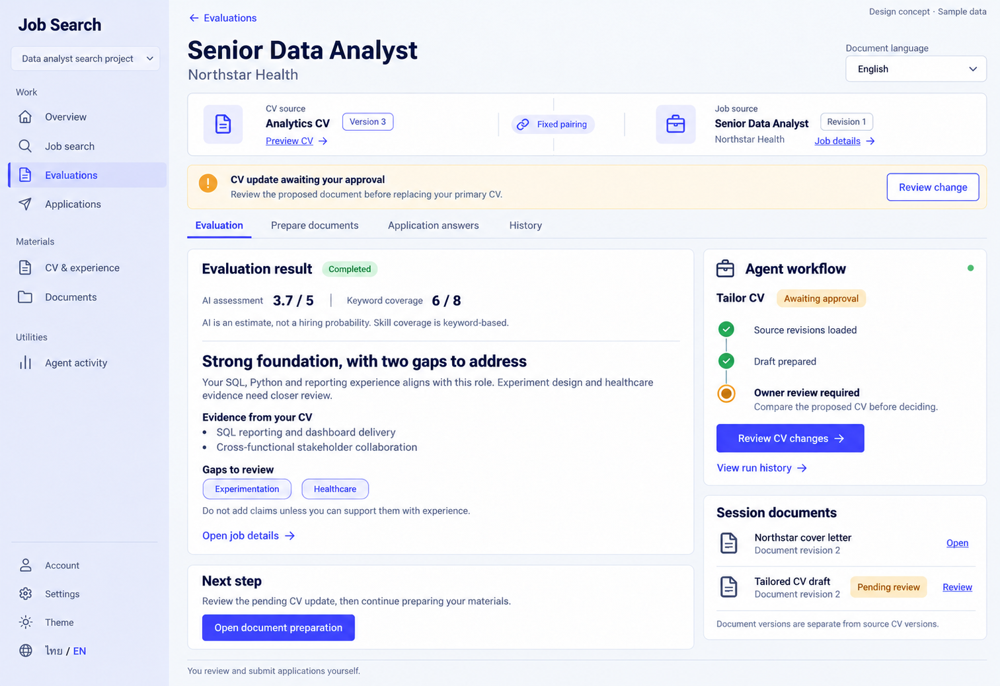

# 04 — Evaluation Session Workspace

Date: 2026-10-16 (Asia/Bangkok). Version: v2. **Owner-approved v2 on 2026-10-16. No application code changed; implementation remains separate.**

[Checklist](CODEX_PAGE_DESIGN_CHECKLIST.md) · [Shared system / worktree](01_OVERVIEW_DESIGN.md) · [Sessions index](03_EVALUATION_SESSIONS_DESIGN.md)

ImageGen concept with synthetic data; desktop/light/English only, not a working browser screenshot. Mobile/dark/Thai images are not generated. Use the current `feat/ux-core-workspaces` worktree and preserve its uncommitted implementation. Approval of this reference and Claude Code implementation are separate steps.

## Version 2 — requested refinements

Owner annotations on v1: (50.5%,14.4%) source pair; (73%,34.3%) agent region. Both are addressed in this image revision. Other page regions and all existing behavior remain governed by the original handoff below. [Previous v1 image](codex_gen_page/04-evaluation-workspace-desktop-light-v1.png) is retained for comparison.

### Paired-source presentation

Use one balanced shared surface: CV source on the left, Job source on the right, with a small central Fixed pairing connector. Each side has one restrained icon, readable name, explicit revision badge and contextual link. Functional source labels are not decorative heading kickers. Replace the oversized arrow; do not add an animated data-flow effect to an immutable pairing.

On mobile, stack CV and job groups with a compact connector between them. Never truncate the revision label or hide Preview/Job details. Hover/focus can emphasize the actual link; neither panel should float, tilt or change size.

### Agent workflow presentation

Use the refined Agent workflow header, operation name, written amber state, compact connected steps and clear owner handoff. Review CV changes opens the existing real change-review surface; it does not approve immediately. Preserve expected-current-CV conflict guards and actual approval scope.

The picture's green header dot is an image-generation detail, not evidence of an active run or a live connection. In this awaiting-approval state use a neutral or amber state marker. Do not claim Connected unless the current connection state is actually available. Completed event checks can remain green; owner review remains amber and stationary.

### Motion specification for Claude Code

This PNG is static. Motion below is a proposed implementation behavior, **not an animated preview or tested animation**. Use the existing frontend's motion approach; no extra animation library is required by this specification.

| Trigger | Motion | Duration / limit |
|---|---|---|
| A genuinely new step is confirmed by a run event | Draw only the newly completed connector segment, then reveal its check. Keep labels stable. | Connector180–240ms, check100–140ms, ease-out. |
| A run actually enters Running | Brief, low-amplitude opacity pulse on the current node. No orbiting decoration, fake progress or moving approval marker. | At most2cycles of1400ms (2.8s total), then a steady Running indicator. |
| Run status changes | Crossfade the changed status/step only; never replay the entire panel on every SSE message. | 120–180ms. |
| Waiting approval or Needs input | Stop processing motion immediately. The owner-handoff line may receive one quiet emphasis on entry, then remain steady. | One180–220ms emphasis; no loop/shimmer/spinner. |
| Completed, Failed, Cancelled or Interrupted | Settle to the correct static icon and written state. Do not celebrate a failed or incomplete operation. | 120–180ms maximum. |
| Review button hover | Subtle existing color transition; optional arrow shift of at most2px. Focus retains a visible stationary ring. | 100–150ms. |
| Reduced motion / hidden page or inactive tab | No pulse, travel, connector draw or entrance replay. Render the final meaningful state directly; pause motion while hidden. | Immediate/static. |

Drive transitions from real state changes, not timers pretending work completed. Deduplicate event identities and do not replay old transitions after SSE reconnect or remount. For fast batches, settle to the latest confirmed state rather than queue decorative playback. Keep text readable throughout, reserve layout space, avoid scroll/focus jumps, and announce actual important state changes politely without narrating animation. All information/actions remain available with animation disabled.

### Additional v2 acceptance gates

- [x] Owner explicitly approved v2 on 2026-10-16.
- [ ] Source groups remain readable at narrow widths and use the exact fixed pair.
- [ ] Motion responds to actual run events; no fake progress, ETA or connection state.
- [ ] Awaiting approval is stationary; Running pulses are bounded and stop immediately on state change.
- [ ] Reduced-motion, hidden/inactive tabs, reconnect deduplication and keyboard focus are verified in the implemented UI.

## Purpose and represented state

Route: `/app/projects/:projectId/sessions/:sessionId`.

Show the exact source pair, evaluation result, current agent operation, required decision and generated materials without conflating them. The pictured example has a **completed evaluation** and a **later Tailor CV operation awaiting approval**. The old score is not the result of the unfinished tailoring task.

Evaluation is the selected tab. Other tab contents are specified below; this single raster does not visually approve every tab/state.

## Components and actions

| Region | Contents / reuse | Behavior |
|---|---|---|
| Project rail / back link | Existing AppShell/ProjectSidebar; Evaluations selected; Back to Evaluations | Preserve project scope, navigation, account, theme and language controls. |
| Header | Session/job title, company, document output-language selector | Preserve session renaming and any existing title-management affordance. UI language and document output language remain separate. Changing language does not rewrite existing results. |
| Source pair strip | Named CV + exact version, preview; job + exact revision, Job details; fixed-pair explanation | Reuse `CvPreviewButton` and existing identity links. Never silently replace the pair with newer project CV/job revisions. |
| Attention notice | Actual pending decision or missing-input state, with contextual Review change / Continue | The pictured CV notice is appropriate only for a real pending CV-promotion request. Other actions use their own actual wording and details. Review opens the corresponding existing review surface; it does not approve. |
| Task tabs | Evaluation; Prepare documents; Application answers; History | Reuse existing Radix Tabs and current tab/state preservation. Keyboard arrows, selected state and narrow-screen access must work. |
| Evaluation result | Completed result, AI score, deterministic coverage, report Markdown | Reuse `RunResults`, score/coverage components and safe Markdown. Preserve actual result identity and null/partial states. |
| Current agent task | Operation, written run status, actual event timeline, contextual controls | Reuse `useRun`, `RunTimeline`, `ApprovalCard` and existing gate logic. Do not invent completed steps, percentage or ETA. |
| Session materials | Actual related document titles/revisions and partial/review state | Reuse existing document links, source-run association, revision handling and TailorCard outputs. Documents must belong to this session. |
| Next step | Contextual guidance and Open document preparation | This is navigation to the existing tab, not a hidden POST starting new work while another run is busy. |
| Footer | Manual-submission reminder | “Applied” is tracking; actual applications are sent by the user. |

Use existing `frontend/src/features/chat/SessionPage.tsx`, `useRun.ts`, `RunTimeline.tsx`, `RunResults.tsx`, `ApprovalCard.tsx`, `TailorCard.tsx` and `ApplyCard.tsx`. Component responsibility labels do not require a second UI library or one new file per region.

## Source, score and document rules

- SessionView is authoritative for the immutable CV/job pair. Resolve the exact job revision through existing job data. RunView does not expose a CV revision field; do not add an invented API property.
- CV preview and filename refer to the session's CV revision/file, not the current primary CV. Missing/deleted source metadata is reported honestly; history remains usable where supported.
- `cv_outdated` shows a newer-version notice and the existing **Start with latest CV** flow. It creates/selects a correctly paired session; it does not mutate this session's source identity.
- Select evaluation data for this session and job, using existing authoritative evaluation-run identity/order. A latest unrelated draft/tailoring operation must not overwrite the displayed evaluation.
- Score is the existing **0–5 evaluation scale**. Keyword coverage remains deterministic and separate; neither is a hiring probability or employer ATS guarantee.
- Report headings, bullets and gap labels in the image are illustrative report content. Render actual supported report Markdown/skill evidence; do not require new structured “foundation”, “evidence” or “gaps” API fields.
- Source **CV version 3** and generated **Document revision 2** are different histories. Promotion may create a new CV revision only through existing validated behavior; document revision 2 does not imply source CV version 2.
- “Tailored CV draft” appears as a document only when an actual published document/revision exists. If tailoring returns proposals instead, show them through existing TailorCard review; do not invent a downloadable document or revision.
- Associate materials with actual runs of this session. Do not show another session's unrelated project documents just to fill the panel. Preserve document revision history and authorized preview/download behavior.

## Run / approval lifecycle — preserve existing contracts

Use current resources, `useRun` REST/SSE connections, event replay/reconnect handling and operation requests. Preserve the existing idempotency key/header/body, retry lineage, account/provider gates and project authorization. No new backend endpoints, SSE event types or substitute polling protocol are proposed.

| State | Required presentation / controls |
|---|---|
| No evaluation yet | Explain the exact pair; offer existing Evaluate this job action when eligible. No example score. |
| Queued / Running | Written state, available real events and existing cancellation behavior where supported. Disable duplicate/mutually exclusive starts; keep tab navigation and saved results accessible. |
| Needs input | Clear missing-input explanation and route to the appropriate existing form/tab. Preserve answers/instructions and required-field validation. |
| Waiting approval | Identify actual request/action, proposed artifact/change and scope. Show expiry/consumed/decision state accurately. No broad approval of all future work. |
| Completed | Show actual result/materials; completion of one run does not mean all tasks or all documents are complete. |
| Failed / Cancelled / Interrupted | Distinct wording, retained useful output, available details and existing retry/resume/cancel rules. Do not map every state to generic Failed. |
| SSE disconnected / status unknown | Connection/recovery indication and existing refresh/reconnect behavior. Never fake terminal completion or duplicate an operation. |

### Approval safety

The amber notice is not authorization to replace a CV. Reuse existing ApprovalCard/TailorCard review, actual approval payload/digest and expected-current-CV guard. The owner must inspect the real proposed change. Handle conflicts, expiry and already-consumed decisions without silently rebasing or forcing promotion. Approval, rejected approval and cancellation remain distinct actions.

The timeline's three example steps are illustrative. Use actual event `step`/`message_key`/status data when available; omit unavailable historical steps rather than claiming they ran. Do not derive a progress percentage from the number of illustrative dots.

## Other tabs and retained capabilities

| Tab | Preserve |
|---|---|
| Prepare documents | Cover letter/application message creation, output language, owner instructions, generated documents, redraft confirmation/new revision, revision instructions, CV tailoring proposals/evidence gate and promotion review. |
| Application answers | Existing ApplyCard question types, required answers, evidence/missing facts, owner-supplied answers, parked/ready states and approval/recording boundaries. Never guess unsupported personal claims. |
| History | Run/retry history, available historical results/events and existing message history. Label unavailable event detail; do not fabricate it. |

Existing advanced controls, owner-instruction drafts, account/provider errors, retry/refresh/cancel actions and session management remain available even if omitted from this Evaluation-tab raster. Preserve existing mount/state behavior where needed to avoid losing user input or duplicating work. Do not copy mount rules blindly to one-time-secret components elsewhere.

Legacy sessions without a pair are read-only history, with the existing Start paired session route. Do not expose unsupported evaluation/document mutations merely because the new layout has action buttons.

## Layout / accessibility / copy

Continue the approved palette, typography, shared components and flat surfaces from Overview/DESIGN. Ignore generated gradients, exaggerated icon sizes or the extra thin selected-navigation stripe if inconsistent with existing tokens. One h1; the Back link is navigation, not a decorative heading kicker.

Desktop: full-width header, paired identity, attention notice and tabs; roughly 68/32 report/activity split. Tablet/mobile: reflow source details and actions without truncating revisions. Priority order is source pair → pending attention → current task/status when actionable → selected tab/result → materials/next actions. On small screens, allow access to all tabs without whole-page overflow. Retain focus and user drafts when switching tabs.

Use semantic headings/links/buttons, accessible tabs and disclosure controls, written states independent of color, visible focus, safe dialog focus return, readable Thai line height, Light/Dark semantic tokens and reduced motion. Output-language selection must not change interface language or translate existing job/CV content.

| EN | TH |
|---|---|
| Evaluation / Prepare documents | ผลประเมิน / เตรียมเอกสาร |
| Application answers / History | คำตอบใบสมัคร / ประวัติ |
| Document language / Fixed source pair | ภาษาเอกสาร / ข้อมูลต้นทางที่จับคู่ไว้ |
| CV update awaiting your approval | การอัปเดต CV รอคุณอนุมัติ |
| Review change / Current agent task | ตรวจการเปลี่ยนแปลง / งาน Agent ปัจจุบัน |
| AI assessment / Keyword coverage | ผลประเมิน AI / ความครอบคลุมทักษะจากคำสำคัญ |
| Session documents / Document revision | เอกสารของเซสชัน / เวอร์ชันเอกสาร |
| Pending review / Next step | รอตรวจสอบ / ขั้นตอนถัดไป |
| Open document preparation | เปิดหน้าเตรียมเอกสาร |

Reuse equivalent locale keys; actual operation/action labels come from supported types. All names, scores and file versions in the image are synthetic placeholders.

## Missing/error states and implementation gates

Independent loading/error states must preserve usable results and navigation. Handle session not found/no access, deleted source, no files, partial results, provider unavailable, unverified/limited account, unavailable source lookup and conflicting promotion. Pending/revision work must not erase earlier documents or the user's drafts.

- [ ] Owner approves this page/version before implementation.
- [ ] Preserve exact pairing, run/approval/retry/idempotency/SSE semantics and all four task tabs.
- [ ] Keep completed result, current task and generated document revisions distinct.
- [ ] Verify busy/missing-input/approval/partial/failure/reconnect/legacy states and actual contextual actions.
- [ ] Verify Thai/English, Light/Dark, desktop/tablet/mobile and keyboard/focus in real UI.
- [ ] Build/typecheck and existing/new relevant Playwright journeys pass with synthetic fixtures; compare actual browser captures without weakening tests.

No application code or tests were changed/run to create this image. Previous frontend passing results are not proof of this proposed layout's implementation.

## Provenance

Built-in ImageGen; desktop/light/English synthetic concept. Exact prompt embedded in the PNG; dimensions/SHA256 in `codex_gen_page/04-evaluation-workspace-v2-manifest.json`. Original output retained. No mobile/dark/Thai image variants yet.
