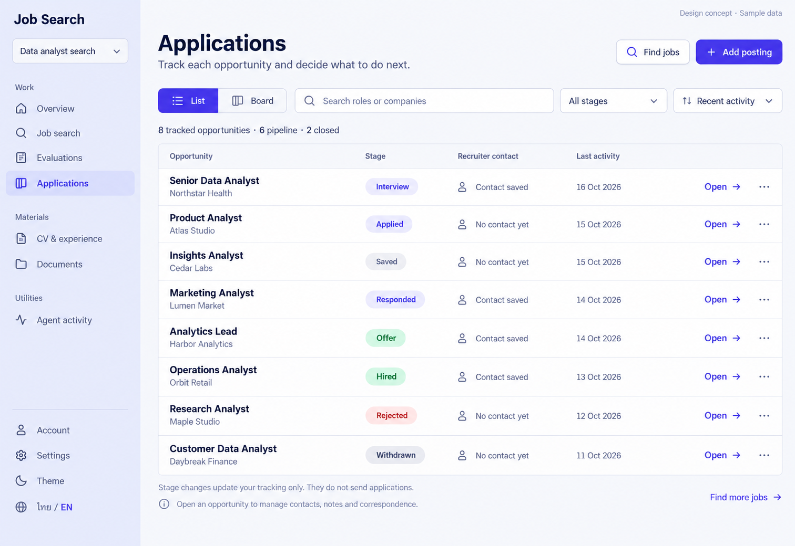

# 05 — Applications tracking

Date: 2026-10-16 (Asia/Bangkok). Version: v1. **Owner approved v1 List — 2026-10-16. Board remains written specification only. No application code changed.**

[Checklist](CODEX_PAGE_DESIGN_CHECKLIST.md) · [Shared visual system / worktree](01_OVERVIEW_DESIGN.md)

ImageGen concept, synthetic desktop/light/English data. **Only List is pictured.** Board, add-posting form and mobile/dark/Thai variants are specified below, not separately image-generated or browser-verified. Implement only after approval in the existing `feat/ux-core-workspaces` worktree; preserve its uncommitted source.

## Purpose and source

Route: `/app/projects/:projectId/applications`; the legacy `/jobs` route continues redirecting here. Track opportunities, find the next record to update and open its contact/notes/correspondence. This is not an automatic application sender.

Reuse `features/jobs/JobsPage.tsx`, `features/applications/ApplicationBoard.tsx`, shared `StatusBadge`, `ItemMenu`, buttons/forms, `applicationStages.ts`, current draft/resource helpers and project navigation. Job Detail/ApplicationPanel remains the separate **page06**; do not insert a second inspector implementation here.

## Components and behavior

| Region | UI | Behavior |
|---|---|---|
| Shared rail | Applications selected; project/account/settings/theme/language retained | Existing project-scoped navigation. |
| Header | Applications title, purpose, Find jobs, Add posting | Find jobs opens project Search. Add posting reveals the existing form and any retained draft. |
| View switch | List default; Board alternative | Keep `?view=board` and existing default/URL semantics; switching views preserves other supported state. |
| Search/filter/sort | Role/company query, exact stage filter, Recent activity | Proposed local filtering/sorting of loaded records; no new backend search API. Offer localized clear/no-match recovery. Keep values while changing List/Board. |
| Compact count line | Tracked total, pipeline count, closed count | Derive from actual scoped records, not image examples. Distinguish full counts from filtered-visible counts when filters apply. |
| List | Opportunity, Stage, Recruiter contact, Last activity, Open and move menu | Job title/Open navigate to Job Detail. Contact column reflects actual availability only. No fake contact details or invented interview/reminder data. |
| Stage menu | Other supported stages, localized labels | Reuse the current menu/update flow; keyboard operation and accessible job-specific label. Do not make the whole row's click swallow the menu. |
| Footer | Tracking-only notice, next-step hint, Find more jobs | Link to real Search/Job Detail capabilities. |

## Existing data and contracts

Existing REST calls under `/api/v1`:

- GET `/projects/{projectId}/applications` returns the current `ApplicationCardView` records: `job_revision_id`, title/company, stage, `has_contact`, created and last-activity timestamps.
- PATCH `/projects/{projectId}/jobs/{job_revision_id}/application-status` with the existing `application_status` body changes the tracking stage.
- POST `/projects/{projectId}/jobs` creates a manually added posting using the existing title/company/description/source fields and validation.

Reuse current resource reload/deduplication/error behavior. No CV, evaluation-score or personal recruiter-name column is proposed: those are not supplied by this list response. “No contact yet” means no recorded contact, not that no recruiter exists.

### Stage semantics

Use exactly the current stages and shared localization:

| Group | Stages |
|---|---|
| Existing pipeline group | Saved, Applied, Responded, Interview, Offer, Hired |
| Existing closed group | Rejected, Withdrawn |

Hired belongs to the existing pipeline grouping. Do not silently move it into the closed enum/group. The image's six pipeline/two closed counts follow that definition, not a promise that six applications are still awaiting a decision.

Stage is a tracking fact. Applied does not send an application; Responded/Interview/Offer/Hired do not manufacture employer communication. Use textual labels and semantic colors; never rely on color alone. A closed record remains openable and can be moved through supported existing actions.

Keep optimistic feedback and failure rollback/reload. A failed change must restore the correct record and report an actionable error; it must not overwrite another successful update or erase notes/contact/history. Prevent conflicting duplicate writes while a record is updating.

Last activity uses `last_activity_at` with the existing created-time fallback. Localize dates; do not infer a particular contact event, next interview, deadline or “today” from unavailable fields. Sort from actual timestamps, with stable ordering for ties.

## Board view — retained, not pictured

- Same scoped/filterable records, shared stage labels and actions as List; view selection survives reload via existing URL state.
- Keep six pipeline columns in the existing order and their actual counts. Empty stages remain visible with a concise empty state.
- Rejected/Withdrawn stay in the existing collapsible Closed section, with its count and individual stage labels. Preserve expanded state across status refreshes rather than collapsing after every move.
- Keep keyboard-accessible move menus. Drag-and-drop is not required and must never be the only way to move a record; no new drag library is required by this design.
- Desktop wide-board scrolling is contained inside its own region. Mobile stacks/reflows the existing columns or offers the readable List alternative; no whole-page horizontal overflow.
- Do not duplicate backend mutations or create separate stage logic for each view. The same record must reflect the same stage in both.

A Board image can be requested later; this List reference does not claim to visually approve an unrendered Board composition.

## Add-posting form — preserve existing capability

Use the existing inline reveal/form, not an unnecessary new modal. Fields: Job title, Company, Source URL and Job description. Preserve project-local drafts across view changes/temporary close. Empty/invalid title or description cannot submit; reject non-HTTP(S) source URLs using the existing helper and retain input after errors.

Keep the current length limits, trim/optional-field behavior, busy guard and single POST/reload flow. Do not silently fetch arbitrary URLs, scrape private hosts, insert model-generated job details or issue a paired-session request from this form. Contact, correspondence and notes are managed in Job Detail through existing APIs.

## States and boundaries

| State | Required UI |
|---|---|
| No tracked opportunities | Clear Find jobs and Add posting actions, without fake table rows. |
| Filters return no rows | Distinguish from empty project; allow clearing filters/search. |
| Loading / read failure | Stable skeleton or scoped Retry; keep navigation and any usable retained data. |
| Stage update pending/fails | Per-record pending feedback and correct rollback/recovery; accessible error message. |
| Add-posting save fails | Keep all fields/draft and actual validation/retry context. |
| Long mixed-language titles | Wrap essential titles/company; retain accessible full name and move/Open actions. |
| Closed records | Readable and actionable, not globally disabled or deleted. |
| Invalid/missing timestamp | Honest unavailable display; do not invent recency. |

No bulk delete, forced history purge, calendar/reminder integration, employer ATS sync, automatic sending or hidden recruiter lookup is introduced by this mock.

## Layout and accessibility

Follow approved Overview/DESIGN tokens, flat surfaces, existing icon family and readable 24–28px headings/14–16px content. Ignore incidental generated shading or typography differences. Keep one h1, purposeful spacing and a single divided list surface instead of nested row cards.

On tablet, reflow controls and secondary metadata before columns become cramped. On mobile, each row becomes a semantic vertical entry: title/company → stage/contact availability → timestamp/Open/menu. Keep Add posting and List/Board reachable; no horizontal page overflow. Keyboard users can switch view, search/filter, open a record and move its stage with visible focus and correct menu return focus.

Preserve TH/EN, user-authored names/content and Light/Dark semantic tokens. New filter/sort controls are client-side proposals and must not imply server-side capabilities. Accessible sort/filter labels should describe their action without depending on icons.

| EN | TH |
|---|---|
| Applications / Add posting | ใบสมัคร / เพิ่มประกาศงาน |
| List / Board | รายการ / บอร์ด |
| Search roles or companies / All stages | ค้นหาตำแหน่งหรือบริษัท / ทุกขั้นตอน |
| Opportunity / Stage | งานที่ติดตาม / ขั้นตอน |
| Recruiter contact / Contact saved | ข้อมูลผู้ติดต่อ / มีข้อมูลผู้ติดต่อ |
| No contact yet / Last activity | ยังไม่มีข้อมูลผู้ติดต่อ / กิจกรรมล่าสุด |
| Open / Recent activity | เปิด / กิจกรรมล่าสุดก่อน |
| Closed / Move to | ปิดแล้ว / ย้ายไปยัง |
| Stage changes update your tracking only. They do not send applications. | การเปลี่ยนขั้นตอนเป็นการบันทึกติดตามของคุณ ระบบไม่ได้ส่งใบสมัคร |

Reuse the existing shared stage translations rather than creating another vocabulary.

## Acceptance after owner approval

- [ ] Preserve existing worktree/source, all eight stages, List/Board URL state and closed-group behavior.
- [ ] Verify local search/filter/sort, actual counts/contact/timestamps and project isolation.
- [ ] Open Job Detail; add a valid posting; reject unsafe source input; preserve drafts and failed-save recovery.
- [ ] Move stages by keyboard; confirm successful refresh and failed-mutation rollback without losing concurrent changes.
- [ ] Verify empty/loading/error, TH/EN, Light/Dark, desktop/tablet/mobile and focus behavior.
- [ ] Build/typecheck and relevant existing/new Playwright regressions pass using synthetic fixtures; compare actual screenshots without weakening tests.

No application implementation or test execution occurred for this draft. Previous passing implementation results do not verify the proposed controls/layout.

## Provenance

Built-in ImageGen, synthetic English desktop/light List. Exact prompt embedded in PNG; dimensions/hash in `codex_gen_page/05-applications-manifest.json`. Original generated output retained. Board/mobile/dark/Thai images are not yet generated.
