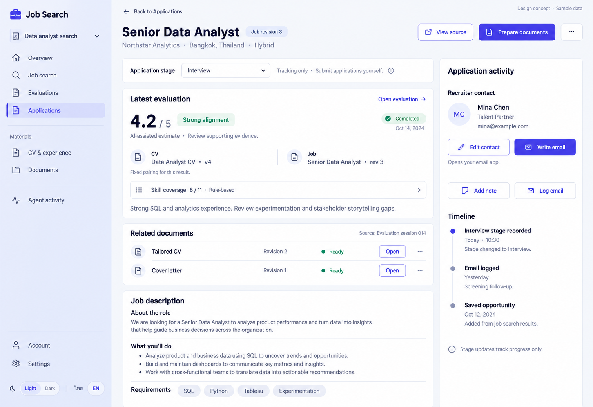

# 06 — Job Detail

Date: 2026-10-16 (Asia/Bangkok). Version: v1. **Owner approved v1 — 2026-10-17. No application code changed.**

[Checklist](CODEX_PAGE_DESIGN_CHECKLIST.md) · [Shared design / implementation worktree](01_OVERVIEW_DESIGN.md)

ImageGen concept with synthetic English desktop/light content. This is not a browser screenshot. Thai, dark, mobile, forms and other states are specified below, not visually verified.

## Purpose and source

Route: `/app/projects/:projectId/jobs/:jobId`. Help users understand an opportunity, inspect the evaluation's exact sources, open generated documents and maintain application history.

Implement later in the existing `feat/ux-core-workspaces` worktree at `/Users/parksurakiat/.codex/worktrees/ux-redesign-plan/AI-Job-Search-Agent-Platform-dem`. Preserve existing uncommitted changes. Reuse `features/jobs/JobsPage.tsx` (`JobDetailPage`), `features/applications/ApplicationPanel.tsx`, `NewSessionButton`, `FitScore`, `SkillCoverage`, `JobRemoveMenu`, existing resource/draft helpers and shared UI components.

## Regions and components

| Region | Components | Required behavior |
|---|---|---|
| Navigation | Shared project rail; Applications selected; back link | Preserve project context and supported navigation state; keep account, settings, language and theme accessible. |
| Header | Title/company/location when available, Job revision badge, View source, Prepare documents, overflow | Show real fields only. Safe external source URL only; missing/unsafe source has no actionable link. Prepare documents reuses saved-job `NewSessionButton` with `{ savedId: job.id }`; preserve existing removal confirmation and recovery. |
| Tracking bar | Localized stage select and tracking-only explanation | Preserve all eight existing stages. Updating a stage records progress; it does not submit an application or contact an employer. Busy/error rollback must remain clear. |
| Latest evaluation | Existing 0–5 score, status, report and Open evaluation | AI-assisted estimate is distinct from deterministic skill coverage. Do not convert this score into Search's percentage estimate. Render report as safe Markdown; retain complete report, not just the pictured summary. |
| Source pairing | CV name/version, exact Job revision, fixed-pair explanation | Resolve immutable session identity for the evaluated run and job. Never substitute today's primary CV. If exact pairing cannot be resolved, show source unavailable and a recovery action, not invented version labels. |
| Skill coverage | Rule-based count and expandable evidence | Preserve actual deterministic output, missing skills and unknown-data explanation. Do not present it as AI confidence. |
| Related documents | Compact rows with type/title, Document revision, actual status, Open | Join documents through source run IDs for this job. Preserve all related documents and all-documents navigation. Partial results stay labeled partial. Do not infer a document's CV revision from its revision number. |
| Job description | Readable safe Markdown and real requirements | Preserve full posting and available metadata. Skill tags require actual structured data; otherwise keep source prose. Never invent fields from the concept. |
| Application activity | Contact details, Edit contact, Write email, Add note, Log email, timeline | Keep contact, correspondence and notes editable. Write email opens a validated, encoded `mailto:` in the user's email client. The platform does not send the email. Timeline uses actual events, actor metadata and localized timestamps. |

## Existing contracts — unchanged

REST paths below are relative to the existing API client base:

- GET `/projects/{projectId}/jobs`, `/runs`, `/documents`; GET `/projects/{projectId}/sessions/{sessionId}` for exact evaluation source pairing. `RunView` has no CV revision field. Require session ID and job revision to match before displaying paired CV identity.
- GET `/projects/{projectId}/jobs/{jobId}/application` returns `ApplicationDetailView`.
- PATCH `/projects/{projectId}/jobs/{jobId}/application-status` with `{application_status}`.
- PUT `/projects/{projectId}/jobs/{jobId}/application/contact` with `{name, email, role}`; preserve existing blank-to-null normalization and validation.
- POST `/projects/{projectId}/jobs/{jobId}/application/events` for `{kind: 'email_logged', direction, subject, occurred_on, note}` or `{kind: 'note', text}`.

Contact editing exposes name, email and role. Log email exposes direction, subject, occurrence date and note; preserve trimming, validation and optional-value semantics. Add note exposes its existing text field. Use accessible inline disclosures or existing dialogs, with labels, cancel/save, busy feedback, field errors and retained drafts after failure. Do not add reminder scheduling, interview booking, ATS sync or new sending endpoints.

## States and accessibility

- Keep job detail readable when application activity, evaluation or documents fail independently. Each failed section has contextual retry; missing/deleted job has a useful back action.
- Loading uses restrained section placeholders and an accessible status. No evaluation offers Prepare documents; no documents explains generation; no contact offers Add contact; an empty timeline explains how to log activity.
- Preserve actual run/session status including running, pending approval, failed and partial. Link to the existing evaluation workspace for progress and approval actions. Never label a waiting run as completed or hide existing controls.
- At desktop use a broad reading column and narrower activity column. At tablet stack activity after the job/evaluation content. At mobile use one column, wrapping actions and long titles/URLs; collapse the rail using existing shell behavior. Keep all forms and actions reachable without horizontal overflow.
- Reuse `DESIGN.md` semantic light/dark tokens. Use existing Thai/English i18n, localized dates and stage labels; Thai body text needs comfortable line height. No hardcoded screenshot text or dates.
- Use semantic headings, links and native/select-equivalent keyboard interaction, visible focus, descriptive control names and text status indicators. Dialog focus is trapped and restored. Announce save/failure without stealing focus. Respect reduced motion; this page needs no decorative animation.

| English | Thai |
|---|---|
| Back to Applications | กลับไปรายการสมัครงาน |
| Job revision | เวอร์ชันประกาศงาน |
| Prepare documents | เตรียมเอกสาร |
| Latest evaluation | ผลประเมินล่าสุด |
| Fixed pairing for this result | คู่ CV และงานที่ใช้อ้างอิงผลนี้ |
| Skill coverage · Rule-based | ความครอบคลุมทักษะ · ตามกฎที่กำหนด |
| Application activity | ประวัติการสมัครงาน |
| Add note / Log email | เพิ่มบันทึก / บันทึกอีเมล |
| Tracking only · Submit applications yourself | บันทึกสถานะเท่านั้น · คุณเป็นผู้ส่งใบสมัครเอง |

## Image interpretation and implementation acceptance

The pictured initials avatar and mild surface color variation are generation artifacts: use the shared flat contact treatment and semantic tokens. The example score, 'Strong alignment' label, dates and document statuses are illustrative; use existing score interpretation and real timestamps/statuses. Overflow actions on documents must only expose existing supported actions. Do not add new APIs to recreate incidental image details.

Before implementation is accepted, run build/type checking and relevant existing Playwright journeys with synthetic fixtures. Add coverage for exact source pairing/unavailable identity, document revisions, safe source link, all tracking stages, note/contact/email logging, failure drafts, keyboard/dialog behavior and responsive Thai/English light/dark variants. Capture actual browser screenshots. **None of these implementation checks was run for this image-only deliverable.**
