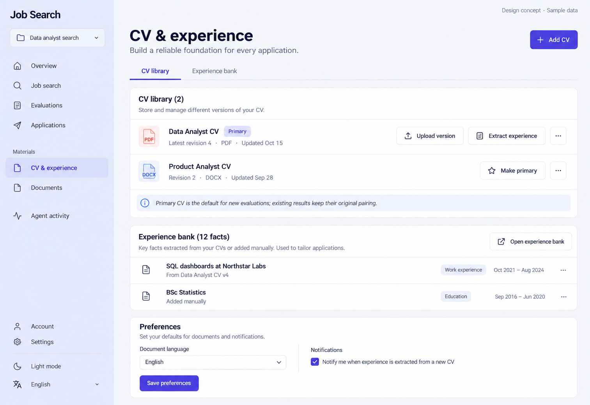

# 07 — CV & Experience

Date: 2026-10-17 (Asia/Bangkok). Version: v1. **Draft awaiting owner review. Not implemented.**

[Checklist](CODEX_PAGE_DESIGN_CHECKLIST.md) · [Shared visual system](01_OVERVIEW_DESIGN.md) · [Batch accessibility and state requirements](CODEX_PAGES_07_16_HANDOFF.md)

Generated design concept, synthetic English desktop/light content. This is not a browser screenshot or evidence of working behavior. Other language/theme/viewport states are specified, not generated or verified.

## Scope and existing implementation

Route: `/app/projects/:projectId/profile`.

Reuse `frontend/src/features/profile/ProfilePage.tsx; profile/ExperienceBank.tsx` (semicolon-separated entries identify related source files). Apply later in `/Users/parksurakiat/.codex/worktrees/ux-redesign-plan/AI-Job-Search-Agent-Platform-dem`, branch `feat/ux-core-workspaces`. Preserve all existing uncommitted work. This handoff authorizes no application changes during the image round.

## Regions and UI components

Select CV & experience in rail. Main heading CV & experience, subtitle Build a reliable foundation for every application; primary Add CV. Two wide tabs CV library and Experience bank, CV library selected. Show two spacious flat rows: Data Analyst CV, Primary badge, Latest revision 4, PDF, Updated Oct 15, actions Upload version / Extract experience / overflow; Product Analyst CV, Revision 2, DOCX, Make primary / overflow. Below, a compact hint Primary CV is the default for new evaluations; existing results keep their original pairing. A separate concise Experience bank preview: 12 facts, source-linked; 2 rows of actual fictional fact copy SQL dashboards at Northstar Labs · From Data Analyst CV v4 and BSc Statistics · Added manually, plus Open experience bank. Bottom simple Preferences section with Document language English dropdown, Notifications checkbox and Save preferences. Avoid scoring CV readiness or inventing ATS metrics.

Use the picture for composition and hierarchy; use `DESIGN.md` and existing primitives for actual tokens, spacing, typography, controls and icon family. Do not copy raster pixels, generated gradients, inconsistent button emphasis or incidental glyphs into production. Main content remains semantic HTML, not a background image.

## Behavior and preserved capabilities

CV library preserves multiple CVs, rename/delete confirmation, make primary, upload new immutable revision and PDF/DOCX/TXT validation using existing limits. Reuse current multipart upload paths and account/provider run gates. Extract experience uses the selected CV and actual queued/running/failed states, stop/retry and provider-not-configured guidance. Experience bank tab retains CRUD for experience, education, skill, certification, project and other, including text, role, organization and period; show actual provenance, duplicate/capacity errors and extraction summary. Facts are evidence, not invented claims. Preferences retain output_language, notifications_enabled and submit_autopilot_daily_limit where supported; advanced settings may disclose the latter, never remove it. Do not imply that the platform sends applications.

## Data and API boundaries

GET project /cvs, /preferences, /experience; POST /cvs and /cvs/{cvId}/revisions via existing FormData file/name; PATCH /cvs/{cvId} for name/is_primary; DELETE existing CV route; POST /cvs/{cvId}/experience-runs; existing run stop route; existing /experience CRUD; PATCH /preferences with existing fields. Resolve exact CV revision provenance rather than current-primary fallback.

Endpoint fragments above describe existing contracts; confirm exact methods, request fields and permission gates in the referenced source before implementation. Never introduce a backend endpoint to match an incidental image detail. All example counts, names, timestamps and badges must come from real scoped data in production.

## Image review notes

The pictured notification explanation is illustrative: preserve the actual notification preference semantics, not an extraction-only notification promise. Upload/extract/rename/delete remain available for every eligible CV, including rows where the image only shows an overflow. The proposed Experience bank tab is local view organization, not a new route or API.

## Bilingual labels

| English | Thai |
|---|---|
| CV & experience | CV และประสบการณ์ |
| Add CV | เพิ่ม CV |
| Experience bank | คลังประสบการณ์ |
| Upload version | อัปโหลดเวอร์ชันใหม่ |

Translate all remaining labels, accessible names and state messages using the current i18n namespaces. Preserve the same meaning and actions in both languages.

## States, responsive behavior and implementation acceptance

Follow the shared [batch requirements](CODEX_PAGES_07_16_HANDOFF.md). Keep loading, empty, error, busy/success and permission states; add running/approval/partial states wherever the real operation supports them. Preserve drafts on retriable failure, avoid duplicate writes and announce results accessibly.

For this page, verify the behaviors and contract boundaries listed above with existing synthetic fixtures and relevant Playwright journeys, including keyboard focus, long Thai content, mobile/tablet, English, light/dark, error recovery and supported URL state. Run frontend build/type checking after code changes. Compare actual screenshots to this concept and fix material defects. **These implementation tests have not been run for this image-only draft.**
