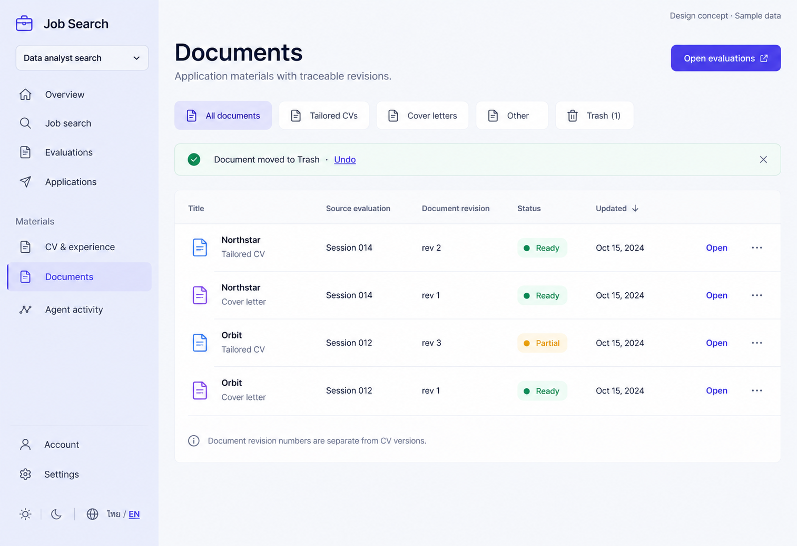

# 08 — Documents

Date: 2026-10-17 (Asia/Bangkok). Version: v1. **Draft awaiting owner review. Not implemented.**

[Checklist](CODEX_PAGE_DESIGN_CHECKLIST.md) · [Shared visual system](01_OVERVIEW_DESIGN.md) · [Batch accessibility and state requirements](CODEX_PAGES_07_16_HANDOFF.md)

Generated design concept, synthetic English desktop/light content. This is not a browser screenshot or evidence of working behavior. Other language/theme/viewport states are specified, not generated or verified.

## Scope and existing implementation

Route: `/app/projects/:projectId/documents`.

Reuse `frontend/src/features/documents/DocumentsPage.tsx; documents/DocumentDeleteMenu.tsx; documents/TrashView.tsx` (semicolon-separated entries identify related source files). Apply later in `/Users/parksurakiat/.codex/worktrees/ux-redesign-plan/AI-Job-Search-Agent-Platform-dem`, branch `feat/ux-core-workspaces`. Preserve all existing uncommitted work. This handoff authorizes no application changes during the image round.

## Regions and UI components

Select Documents in rail. Main title Documents, subtitle Application materials with traceable revisions. Action Open evaluations. Compact filters All documents selected, Tailored CVs, Cover letters, Other, Trash (1). Flat list table Title / Source evaluation / Document revision / Status / Updated / action. Four rows: Northstar — Tailored CV / Session 014 / rev2 / Ready / Oct15 / Open; Northstar — Cover letter / Session014 / rev1 / Ready; Orbit — Tailored CV / Session012 / rev3 / Partial (amber); Orbit — Cover letter / Session012 / rev1 / Ready. Each row includes small document icon and type, modest overflow. Bottom quiet source note Document revision numbers are separate from CV versions. Show thin inline undo banner Document moved to Trash · Undo. No fake download-all or new-document button.

Use the picture for composition and hierarchy; use `DESIGN.md` and existing primitives for actual tokens, spacing, typography, controls and icon family. Do not copy raster pixels, generated gradients, inconsistent button emphasis or incidental glyphs into production. Main content remains semantic HTML, not a background image.

## Behavior and preserved capabilities

Preserve existing type filters, URL trash-view state and session source links. Use actual document fields and supported type labels; image labels are examples. Each Open goes to detail; retain download/menu actions only where supported. Trash supports restore, permanent deletion confirmation and existing pending-approval handling, with undo for reversible trash action. Preserve partial labels. No new upload/create/download-all workflow. Empty collection guides to an existing evaluation; empty filter offers reset without discarding project context.

## Data and API boundaries

GET /projects/{projectId}/documents, /documents/trash and /sessions. Existing DELETE /documents/{documentId} moves to trash; POST /documents/{documentId}/restore; DELETE /documents/{documentId}/permanent. Reuse existing wrappers and approval-required error behavior. Download existing authorized file route only.

Endpoint fragments above describe existing contracts; confirm exact methods, request fields and permission gates in the referenced source before implementation. Never introduce a backend endpoint to match an incidental image detail. All example counts, names, timestamps and badges must come from real scoped data in production.

## Image review notes

The updated-column arrow is a visual proposal; use local sorting only if implemented with tests, never invent a server sort query. Do not claim Ready from absence of partial alone if the data has another state. Use internal-link icons for internal navigation rather than the pictured external-link glyph.

## Bilingual labels

| English | Thai |
|---|---|
| Documents | เอกสาร |
| Document revision | เวอร์ชันเอกสาร |
| Partial document | เอกสารยังไม่สมบูรณ์ |
| Trash / Restore | ถังขยะ / กู้คืน |

Translate all remaining labels, accessible names and state messages using the current i18n namespaces. Preserve the same meaning and actions in both languages.

## States, responsive behavior and implementation acceptance

Follow the shared [batch requirements](CODEX_PAGES_07_16_HANDOFF.md). Keep loading, empty, error, busy/success and permission states; add running/approval/partial states wherever the real operation supports them. Preserve drafts on retriable failure, avoid duplicate writes and announce results accessibly.

For this page, verify the behaviors and contract boundaries listed above with existing synthetic fixtures and relevant Playwright journeys, including keyboard focus, long Thai content, mobile/tablet, English, light/dark, error recovery and supported URL state. Run frontend build/type checking after code changes. Compare actual screenshots to this concept and fix material defects. **These implementation tests have not been run for this image-only draft.**
