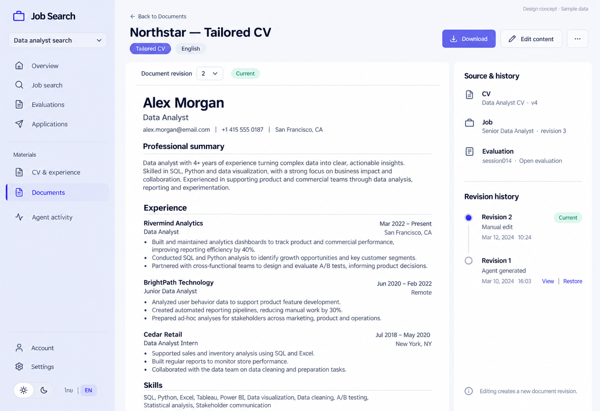

# 09 — Document Detail

Date: 2026-10-17 (Asia/Bangkok). Version: v1. **Draft awaiting owner review. Not implemented.**

[Checklist](CODEX_PAGE_DESIGN_CHECKLIST.md) · [Shared visual system](01_OVERVIEW_DESIGN.md) · [Batch accessibility and state requirements](CODEX_PAGES_07_16_HANDOFF.md)

Generated design concept, synthetic English desktop/light content. This is not a browser screenshot or evidence of working behavior. Other language/theme/viewport states are specified, not generated or verified.

## Scope and existing implementation

Route: `/app/projects/:projectId/documents/:documentId`.

Reuse `frontend/src/features/documents/DocumentsPage.tsx (DocumentDetailPage and editor); documents/DocumentDeleteMenu.tsx` (semicolon-separated entries identify related source files). Apply later in `/Users/parksurakiat/.codex/worktrees/ux-redesign-plan/AI-Job-Search-Agent-Platform-dem`, branch `feat/ux-core-workspaces`. Preserve all existing uncommitted work. This handoff authorizes no application changes during the image round.

## Regions and UI components

Select Documents. Back to Documents. Header Northstar — Tailored CV, badges Tailored CV and English. Header actions Download, Edit content, overflow. Main large white readable document preview with top bar Document revision [2 dropdown] and Current badge. Resume title Alex Morgan, Data Analyst, sections Professional summary, Experience with three concise bullets, Skills. It is a fictional text document, not an image screenshot inside screenshot. Right narrower sidebar Source & history: CV Data Analyst CV · v4, Job Senior Data Analyst · revision3, Evaluation session014 · Open evaluation; missing fields never invented. Revision history two entries Revision2 · Manual edit · Current and Revision1 · Agent generated · View / Restore. Footer note Editing creates a new document revision. Clean page-like reading surface no nested framed boxes.

Use the picture for composition and hierarchy; use `DESIGN.md` and existing primitives for actual tokens, spacing, typography, controls and icon family. Do not copy raster pixels, generated gradients, inconsistent button emphasis or incidental glyphs into production. Main content remains semantic HTML, not a background image.

## Behavior and preserved capabilities

Preserve revision selector and safe Markdown preview, explicit document language, edit draft/cancel/save/retry, run-backed asynchronous save and revision restore polling. Keep older revisions inspectable; selected historical version must not look current. Source CV/job/session identities require actual revision/run/session evidence; unresolved provenance must say unavailable. Preserve authorized file downloads per revision and existing promote-to-CV confirmation with expected current CV revision. Keep trash restore/permanent-delete mode and confirmation. Do not implement a fake WYSIWYG editor; existing content_markdown editor remains the writing contract.

## Data and API boundaries

GET project /documents, /documents/trash, /documents/{id}/revisions, /cv, /sessions and /runs. POST /documents/{id}/revisions {content_markdown}; POST /documents/{id}/revisions/{revisionId}/restore; poll actual /runs/{runId} until terminal per existing behavior. POST /cv/promote {revision_id, expected_cv_revision_id}. Download /api/v1/projects/{projectId}/files/{fileId}/download. No primary-CV fallback for provenance.

Endpoint fragments above describe existing contracts; confirm exact methods, request fields and permission gates in the referenced source before implementation. Never introduce a backend endpoint to match an incidental image detail. All example counts, names, timestamps and badges must come from real scoped data in production.

## Image review notes

Resume achievements, contact details and dates are fictional design content. Never copy generated claims into user documents. Show CV/job source identity per selected revision when resolvable, not a single misleading current source for every historical revision.

## Bilingual labels

| English | Thai |
|---|---|
| Edit content | แก้ไขเนื้อหา |
| Revision history | ประวัติเวอร์ชัน |
| Source & history | แหล่งอ้างอิงและประวัติ |
| Download | ดาวน์โหลด |

Translate all remaining labels, accessible names and state messages using the current i18n namespaces. Preserve the same meaning and actions in both languages.

## States, responsive behavior and implementation acceptance

Follow the shared [batch requirements](CODEX_PAGES_07_16_HANDOFF.md). Keep loading, empty, error, busy/success and permission states; add running/approval/partial states wherever the real operation supports them. Preserve drafts on retriable failure, avoid duplicate writes and announce results accessibly.

For this page, verify the behaviors and contract boundaries listed above with existing synthetic fixtures and relevant Playwright journeys, including keyboard focus, long Thai content, mobile/tablet, English, light/dark, error recovery and supported URL state. Run frontend build/type checking after code changes. Compare actual screenshots to this concept and fix material defects. **These implementation tests have not been run for this image-only draft.**
