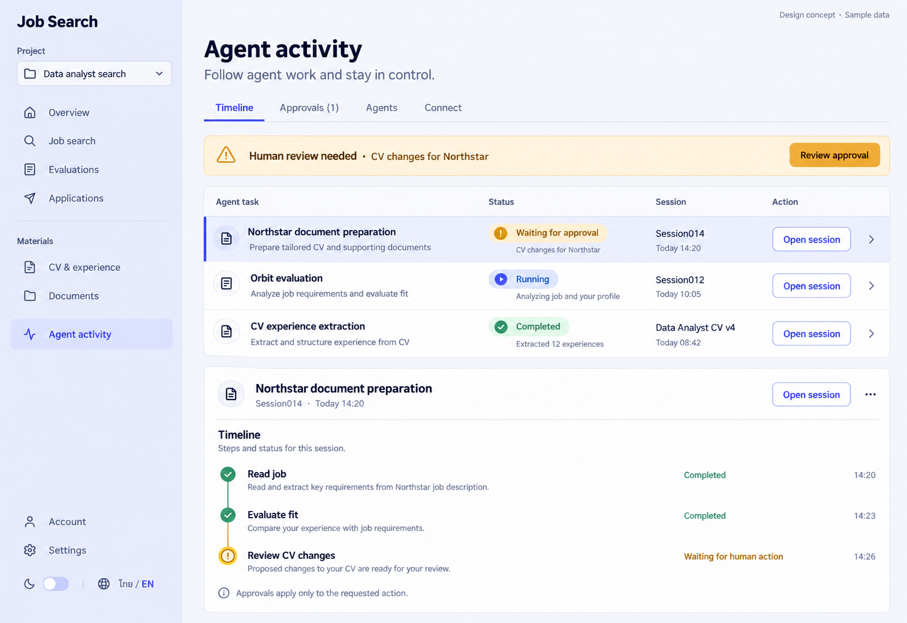

# 10 — Agent Activity

Date: 2026-10-17 (Asia/Bangkok). Version: v1. **Draft awaiting owner review. Not implemented.**

[Checklist](CODEX_PAGE_DESIGN_CHECKLIST.md) · [Shared visual system](01_OVERVIEW_DESIGN.md) · [Batch accessibility and state requirements](CODEX_PAGES_07_16_HANDOFF.md)

Generated design concept, synthetic English desktop/light content. This is not a browser screenshot or evidence of working behavior. Other language/theme/viewport states are specified, not generated or verified.

## Scope and existing implementation

Route: `/app/projects/:projectId/console`.

Reuse `frontend/src/features/console/ConsolePage.tsx; console/TimelineTab.tsx; console/ApprovalsTab.tsx; console/AgentsTab.tsx; console/ConnectTab.tsx` (semicolon-separated entries identify related source files). Apply later in `/Users/parksurakiat/.codex/worktrees/ux-redesign-plan/AI-Job-Search-Agent-Platform-dem`, branch `feat/ux-core-workspaces`. Preserve all existing uncommitted work. This handoff authorizes no application changes during the image round.

## Regions and UI components

Select Agent activity in rail. Heading Agent activity, subtitle Follow agent work and stay in control. Tabs Timeline selected, Approvals (1), Agents, Connect. Prominent modest amber row Human review needed · CV changes for Northstar · Review approval. Below a clean activity list: Northstar document preparation / Waiting for approval / Session014 / Open session; Orbit evaluation / Running / Session012 / Open session; CV experience extraction / Completed / Data Analyst CV v4. Selected timeline detail below list shows completed Read job, completed Evaluate fit, waiting Review CV changes. Waiting explicitly human action with no spinning dots. Small quiet note Approvals apply only to the requested action. No terminal code wall or invented live connectivity indicator.

Use the picture for composition and hierarchy; use `DESIGN.md` and existing primitives for actual tokens, spacing, typography, controls and icon family. Do not copy raster pixels, generated gradients, inconsistent button emphasis or incidental glyphs into production. Main content remains semantic HTML, not a background image.

## Behavior and preserved capabilities

Preserve four URL tab values timeline/approvals/agents/connect. Timeline uses real runs/jobs and existing live update semantics; show queued, running, waiting, completed, failed/cancelled distinctly without inventing token or progress metrics. Approvals preserve exact target identity, action details, account gates, allow/deny decision state and stale/duplicate recovery. Agents retains capability-grant issue/revoke, expiry validation and one-time issued secret treatment. Connect retains existing connection instructions and capabilities without exposing credentials. The image shows Timeline only; other tabs are written requirements, not separately visually approved.

## Data and API boundaries

GET project /runs and /jobs; existing run/event updates. GET /approvals and target /runs/{id}; POST /approvals/{approvalId}/decision with existing decision values. GET/POST /grants and DELETE /grants/{id} using existing capability and expiry schemas. Preserve all SSE reconnect/terminal/approval semantics and project authorization.

Endpoint fragments above describe existing contracts; confirm exact methods, request fields and permission gates in the referenced source before implementation. Never introduce a backend endpoint to match an incidental image detail. All example counts, names, timestamps and badges must come from real scoped data in production.

## Image review notes

An experience-extraction run may have no evaluation session: route its action to existing run detail or CV context, not a fabricated Open session destination. The expanded timeline is a proposed presentation of actual events, not permission to synthesize stages or progress. Session 014 display text must resolve to the real session ID.

## Bilingual labels

| English | Thai |
|---|---|
| Agent activity | กิจกรรมเอเจนต์ |
| Timeline | ลำดับกิจกรรม |
| Approvals | คำขออนุมัติ |
| Waiting for approval | รอการอนุมัติ |

Translate all remaining labels, accessible names and state messages using the current i18n namespaces. Preserve the same meaning and actions in both languages.

## States, responsive behavior and implementation acceptance

Follow the shared [batch requirements](CODEX_PAGES_07_16_HANDOFF.md). Keep loading, empty, error, busy/success and permission states; add running/approval/partial states wherever the real operation supports them. Preserve drafts on retriable failure, avoid duplicate writes and announce results accessibly.

For this page, verify the behaviors and contract boundaries listed above with existing synthetic fixtures and relevant Playwright journeys, including keyboard focus, long Thai content, mobile/tablet, English, light/dark, error recovery and supported URL state. Run frontend build/type checking after code changes. Compare actual screenshots to this concept and fix material defects. **These implementation tests have not been run for this image-only draft.**
