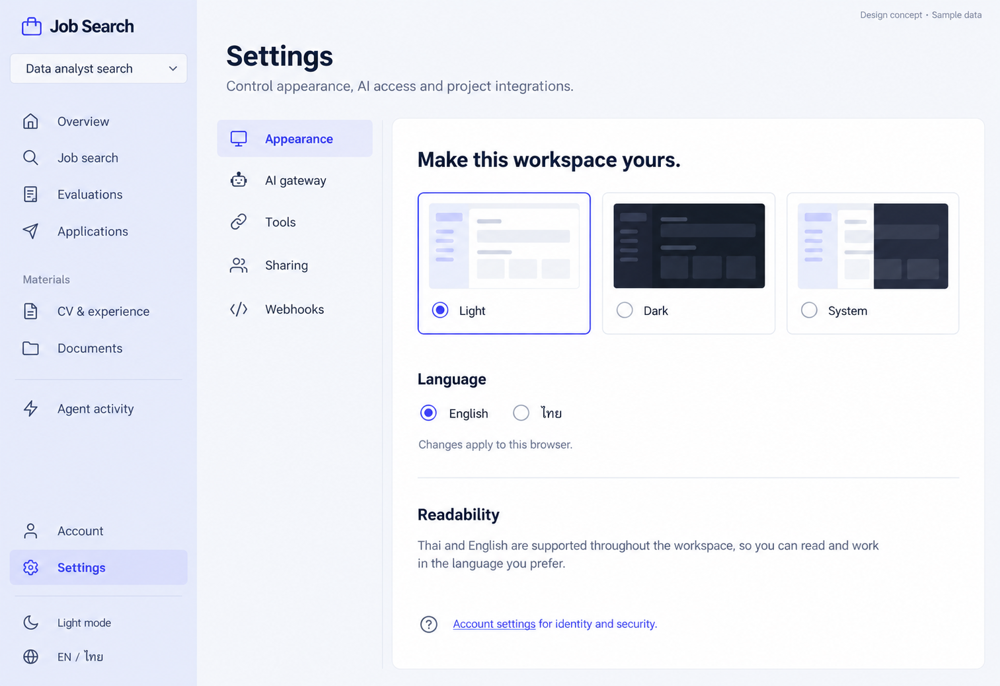

# 11 — Settings

Date: 2026-10-17 (Asia/Bangkok). Version: v1. **Draft awaiting owner review. Not implemented.**

[Checklist](CODEX_PAGE_DESIGN_CHECKLIST.md) · [Shared visual system](01_OVERVIEW_DESIGN.md) · [Batch accessibility and state requirements](CODEX_PAGES_07_16_HANDOFF.md)

Generated design concept, synthetic English desktop/light content. This is not a browser screenshot or evidence of working behavior. Other language/theme/viewport states are specified, not generated or verified.

## Scope and existing implementation

Route: `/app/settings`.

Reuse `frontend/src/features/settings/SettingsPage.tsx and existing AppearanceSettings, GatewaySettings, ToolSettings, ProjectSharing, WebhookSettings, TelegramSettings` (semicolon-separated entries identify related source files). Apply later in `/Users/parksurakiat/.codex/worktrees/ux-redesign-plan/AI-Job-Search-Agent-Platform-dem`, branch `feat/ux-core-workspaces`. Preserve all existing uncommitted work. This handoff authorizes no application changes during the image round.

## Regions and UI components

Keep shared rail, Settings selected, main title Settings, subtitle Control appearance, AI access and project integrations. Within page a compact 190px section navigation Appearance selected, AI gateway, Tools, Sharing, Webhooks. Main white simple content Appearance: heading Make this workspace yours. Theme choices three equal restrained preview tiles Light selected, Dark, System (schematic UI thumbnails only). Language radio English selected / ไทย. Helpful note Changes apply to this browser. Thin divider then comfortable Readability explanatory text Thai and English are supported throughout the workspace, no invented font-size control. Bottom small help link Account settings for identity and security. Huge whitespace instead of unnecessary settings.

Use the picture for composition and hierarchy; use `DESIGN.md` and existing primitives for actual tokens, spacing, typography, controls and icon family. Do not copy raster pixels, generated gradients, inconsistent button emphasis or incidental glyphs into production. Main content remains semantic HTML, not a background image.

## Behavior and preserved capabilities

Preserve section and project URL params. Appearance uses existing theme/language persistence, exact supported theme options and live locale; sample System option must be omitted if source supports only light/dark. AI gateway retains read-only/configured/provider/status and existing operations, never a fake credential input. Tools, Sharing and Webhooks require explicit scoped project selection with no-project recovery. Preserve tool configuration/secret masking, capability grants/expiry/revocation and one-time secret display; webhook create/toggle/test/delivery/redeliver/delete and approval/error semantics. Telegram is account-scoped within Webhooks; label scope distinctly. The image covers Appearance only; all other sections remain required.

## Data and API boundaries

Reuse existing AppearanceSettings theme/locale APIs; GET /gateway; GET /projects; project /settings/tools and career_ops PUT; /grants issue/revoke; /webhooks and /deliveries existing operations; /account/telegram status/link/unlink. Preserve existing schema/permissions and never put tokens in URL, screenshot fixture, logs or persisted drafts.

Endpoint fragments above describe existing contracts; confirm exact methods, request fields and permission gates in the referenced source before implementation. Never introduce a backend endpoint to match an incidental image detail. All example counts, names, timestamps and badges must come from real scoped data in production.

## Image review notes

AppearanceSettings source confirms Light, Dark and System are supported. Changes apply immediately using existing persistence; do not invent a Save button or readability/font-size setting. Other settings sections are not pictured.

## Bilingual labels

| English | Thai |
|---|---|
| Settings | การตั้งค่า |
| Appearance | รูปลักษณ์ |
| Sharing | การแชร์ |
| Project scope | ขอบเขตโปรเจกต์ |

Translate all remaining labels, accessible names and state messages using the current i18n namespaces. Preserve the same meaning and actions in both languages.

## States, responsive behavior and implementation acceptance

Follow the shared [batch requirements](CODEX_PAGES_07_16_HANDOFF.md). Keep loading, empty, error, busy/success and permission states; add running/approval/partial states wherever the real operation supports them. Preserve drafts on retriable failure, avoid duplicate writes and announce results accessibly.

For this page, verify the behaviors and contract boundaries listed above with existing synthetic fixtures and relevant Playwright journeys, including keyboard focus, long Thai content, mobile/tablet, English, light/dark, error recovery and supported URL state. Run frontend build/type checking after code changes. Compare actual screenshots to this concept and fix material defects. **These implementation tests have not been run for this image-only draft.**
