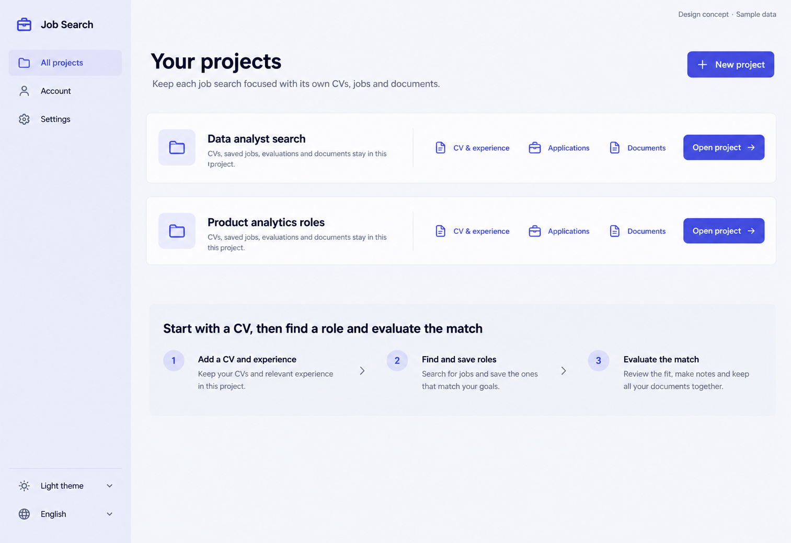

# 12 — Projects

Date: 2026-10-17 (Asia/Bangkok). Version: v1. **Draft awaiting owner review. Not implemented.**

[Checklist](CODEX_PAGE_DESIGN_CHECKLIST.md) · [Shared visual system](01_OVERVIEW_DESIGN.md) · [Batch accessibility and state requirements](CODEX_PAGES_07_16_HANDOFF.md)

Generated design concept, synthetic English desktop/light content. This is not a browser screenshot or evidence of working behavior. Other language/theme/viewport states are specified, not generated or verified.

## Scope and existing implementation

Route: `/app/projects`.

Reuse `frontend/src/features/projects/ProjectsPage.tsx; projects/PageStates.tsx` (semicolon-separated entries identify related source files). Apply later in `/Users/parksurakiat/.codex/worktrees/ux-redesign-plan/AI-Job-Search-Agent-Platform-dem`, branch `feat/ux-core-workspaces`. Preserve all existing uncommitted work. This handoff authorizes no application changes during the image round.

## Regions and UI components

Use slim global left rail Job Search, All projects selected, Account, Settings and bottom theme/language. No project selected. Main heading Your projects and subtitle Keep each job search focused with its own CVs, jobs and documents. Primary New project top right. Two broad flat project rows rather than decorative cards: Data analyst search, description CVs, saved jobs, evaluations and documents stay in this project, Open project button and links CV & experience / Applications / Documents. Second project Product analytics roles, same links and Open project. Lower quiet onboarding strip Start with a CV, then find a role and evaluate the match, with three simple numbered text steps. No fake counts, activity timestamp, collaborator avatar or completion percentage. Spacious mature desktop design.

Use the picture for composition and hierarchy; use `DESIGN.md` and existing primitives for actual tokens, spacing, typography, controls and icon family. Do not copy raster pixels, generated gradients, inconsistent button emphasis or incidental glyphs into production. Main content remains semantic HTML, not a background image.

## Behavior and preserved capabilities

Use actual project names from owner-visible collection and only metadata that exists. Open project targets its Overview, direct links retain that project's identity. New project uses existing route. Do not add archive/delete/share/search actions without source support. Empty state has one clear Create a project action and plain explanation. Loading/error retry preserve global navigation and account access. Do not expose cross-project data in previews or fabricate aggregate counts.

## Data and API boundaries

GET /projects with existing owner authorization; navigation /app/projects/{id}/overview, /profile, /applications and /documents; create route /app/projects/new. No new project metadata writes or contract changes.

Endpoint fragments above describe existing contracts; confirm exact methods, request fields and permission gates in the referenced source before implementation. Never introduce a backend endpoint to match an incidental image detail. All example counts, names, timestamps and badges must come from real scoped data in production.

## Image review notes

Project descriptions and onboarding copy are explanatory UI, not newly stored project fields. Global rail is a shell presentation proposal; retain access to all existing global navigation.

## Bilingual labels

| English | Thai |
|---|---|
| Your projects | โปรเจกต์ของคุณ |
| New project | สร้างโปรเจกต์ |
| Open project | เปิดโปรเจกต์ |
| All projects | โปรเจกต์ทั้งหมด |

Translate all remaining labels, accessible names and state messages using the current i18n namespaces. Preserve the same meaning and actions in both languages.

## States, responsive behavior and implementation acceptance

Follow the shared [batch requirements](CODEX_PAGES_07_16_HANDOFF.md). Keep loading, empty, error, busy/success and permission states; add running/approval/partial states wherever the real operation supports them. Preserve drafts on retriable failure, avoid duplicate writes and announce results accessibly.

For this page, verify the behaviors and contract boundaries listed above with existing synthetic fixtures and relevant Playwright journeys, including keyboard focus, long Thai content, mobile/tablet, English, light/dark, error recovery and supported URL state. Run frontend build/type checking after code changes. Compare actual screenshots to this concept and fix material defects. **These implementation tests have not been run for this image-only draft.**
