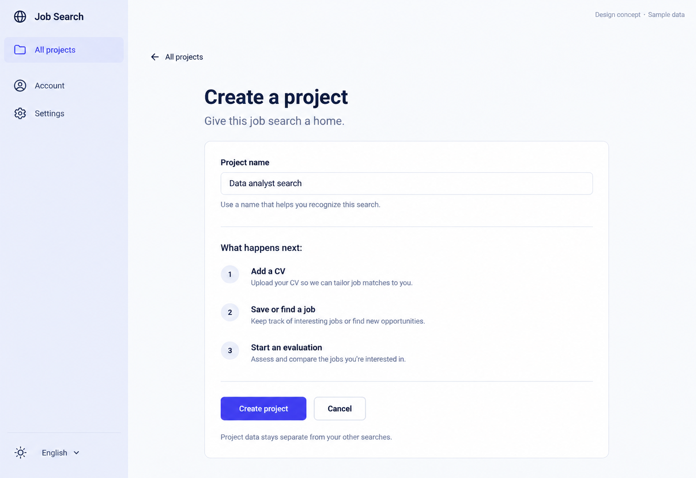

# 13 — New Project

Date: 2026-10-17 (Asia/Bangkok). Version: v1. **Draft awaiting owner review. Not implemented.**

[Checklist](CODEX_PAGE_DESIGN_CHECKLIST.md) · [Shared visual system](01_OVERVIEW_DESIGN.md) · [Batch accessibility and state requirements](CODEX_PAGES_07_16_HANDOFF.md)

Generated design concept, synthetic English desktop/light content. This is not a browser screenshot or evidence of working behavior. Other language/theme/viewport states are specified, not generated or verified.

## Scope and existing implementation

Route: `/app/projects/new`.

Reuse `frontend/src/features/projects/NewProjectPage.tsx; app/drafts.tsx` (semicolon-separated entries identify related source files). Apply later in `/Users/parksurakiat/.codex/worktrees/ux-redesign-plan/AI-Job-Search-Agent-Platform-dem`, branch `feat/ux-core-workspaces`. Preserve all existing uncommitted work. This handoff authorizes no application changes during the image round.

## Regions and UI components

Global rail Job Search, All projects selected, Account, Settings, theme/language. Main narrow content 660px, back All projects. Heading Create a project. Subtitle Give this job search a home. Simple white form with Project name label, populated example Data analyst search, helper Use a name that helps you recognize this search. Under field a quiet divided explanatory section What happens next: 1 Add a CV 2 Save or find a job 3 Start an evaluation, as text steps not interactive wizard. Primary Create project and secondary Cancel. Footer Project data stays separate from your other searches. Only ONE actual input; no role, location, template, provider or team controls. Elegant balanced whitespace.

Use the picture for composition and hierarchy; use `DESIGN.md` and existing primitives for actual tokens, spacing, typography, controls and icon family. Do not copy raster pixels, generated gradients, inconsistent button emphasis or incidental glyphs into production. Main content remains semantic HTML, not a background image.

## Behavior and preserved capabilities

Only name is submitted. Preserve trimmed required validation, maxLength 200, draft persistence, pending-ref duplicate submit prevention, busy feedback and name retention on failure. Successful POST navigates directly to the new project's Profile for CV setup. On ambiguous creation failure retain existing warning and link to Projects to check whether it was created before retry; do not automatically resubmit. Cancel navigates to Projects under existing draft policy. Explanatory next steps are not a multi-step wizard.

## Data and API boundaries

POST /projects {name: trimmedName}; response id navigates /app/projects/{id}/profile. Preserve current useDraft behavior and existing error semantics. No new fields, duplicate name assumptions or backend changes.

Endpoint fragments above describe existing contracts; confirm exact methods, request fields and permission gates in the referenced source before implementation. Never introduce a backend endpoint to match an incidental image detail. All example counts, names, timestamps and badges must come from real scoped data in production.

## Image review notes

The name is an example, not a default automatically submitted. Explanatory next steps do not collect hidden inputs or create resources beyond the existing project POST.

The selected image is the corrected generation: unsupported Home/Saved jobs/Notifications menus and the extra toolbar were removed. Keep theme and language as separately labeled accessible controls, even though the image compresses them into a small bottom row. Use the same Job Search wordmark/icon as other pages.

## Bilingual labels

| English | Thai |
|---|---|
| Create a project | สร้างโปรเจกต์ |
| Project name | ชื่อโปรเจกต์ |
| What happens next | ขั้นตอนถัดไป |
| Cancel | ยกเลิก |

Translate all remaining labels, accessible names and state messages using the current i18n namespaces. Preserve the same meaning and actions in both languages.

## States, responsive behavior and implementation acceptance

Follow the shared [batch requirements](CODEX_PAGES_07_16_HANDOFF.md). Keep loading, empty, error, busy/success and permission states; add running/approval/partial states wherever the real operation supports them. Preserve drafts on retriable failure, avoid duplicate writes and announce results accessibly.

For this page, verify the behaviors and contract boundaries listed above with existing synthetic fixtures and relevant Playwright journeys, including keyboard focus, long Thai content, mobile/tablet, English, light/dark, error recovery and supported URL state. Run frontend build/type checking after code changes. Compare actual screenshots to this concept and fix material defects. **These implementation tests have not been run for this image-only draft.**
