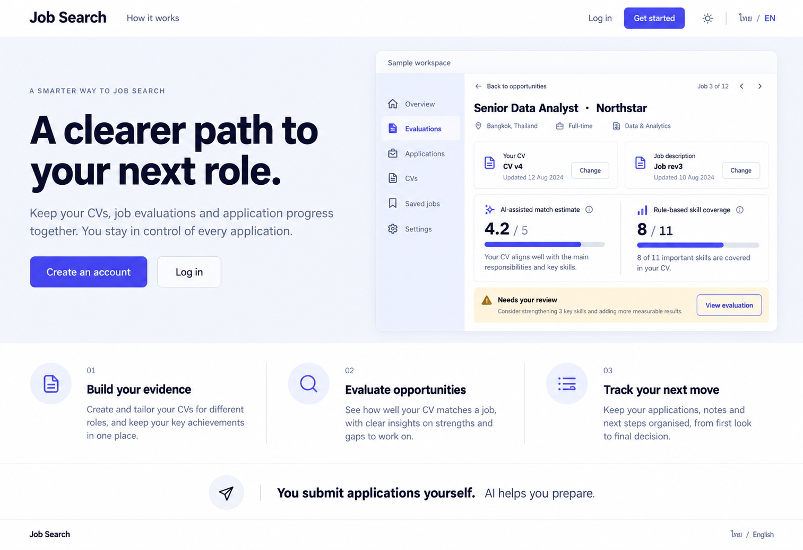

# 14 — Public Landing

Date: 2026-10-17 (Asia/Bangkok). Version: v1. **Draft awaiting owner review. Not implemented.**

[Checklist](CODEX_PAGE_DESIGN_CHECKLIST.md) · [Shared visual system](01_OVERVIEW_DESIGN.md) · [Batch accessibility and state requirements](CODEX_PAGES_07_16_HANDOFF.md)

Generated design concept, synthetic English desktop/light content. This is not a browser screenshot or evidence of working behavior. Other language/theme/viewport states are specified, not generated or verified.

## Scope and existing implementation

Route: `/`.

Reuse `frontend/src/features/landing/LandingPage.tsx; components/Header.tsx; landing copy/locales` (semicolon-separated entries identify related source files). Apply later in `/Users/parksurakiat/.codex/worktrees/ux-redesign-plan/AI-Job-Search-Agent-Platform-dem`, branch `feat/ux-core-workspaces`. Preserve all existing uncommitted work. This handoff authorizes no application changes during the image round.

## Regions and UI components

NO app rail. Public top nav wordmark Job Search, How it works anchor, Log in text link, Get started indigo button, theme icon and ไทย/EN. Editorial hero left 55%: headline A clearer path to your next role. Short copy Keep your CVs, job evaluations and application progress together. You stay in control of every application. Buttons Create an account and Log in. Right 45% a beautifully arranged product preview: compact realistic evaluation panel Senior Data Analyst · Northstar, CV v4 paired with Job rev3, AI-assisted estimate 4.2/5, separate Rule-based skill coverage 8/11, Needs your review status, View evaluation. Explicit Sample workspace label. Lower section One focused workflow with three columns 01 Build your evidence / 02 Evaluate opportunities / 03 Track your next move, each concise sentence and simple line icon. Bottom white strip clear boundary You submit applications yourself. AI helps you prepare. Footer Job Search · ไทย / English. No fake testimonials, logos, metrics, pricing, guarantees, decorative gradients.

Use the picture for composition and hierarchy; use `DESIGN.md` and existing primitives for actual tokens, spacing, typography, controls and icon family. Do not copy raster pixels, generated gradients, inconsistent button emphasis or incidental glyphs into production. Main content remains semantic HTML, not a background image.

## Behavior and preserved capabilities

Preserve existing public Header and authentication-aware navigation. Hero CTAs use existing signup/login or authenticated workspace routing; workflow items may be anchors only to real sections. Product preview is labeled illustrative and contains no real user data. Preserve source-supported local/agent distinction and any remaining explanatory sections below the first viewport; do not promise hosted AI is configured, guaranteed scores or automatic application submission. Navigation is keyboard accessible and usable on small screens.

## Data and API boundaries

Public route only; reuse current auth/session-aware routing and existing landing copy. No new account API, pricing, public analytics or invented backend capability. Any preview is static synthetic marketing content and must be marked as such.

Endpoint fragments above describe existing contracts; confirm exact methods, request fields and permission gates in the referenced source before implementation. Never introduce a backend endpoint to match an incidental image detail. All example counts, names, timestamps and badges must come from real scoped data in production.

## Image review notes

The evaluation preview is static illustrative content. Preserve existing SearchTeaser, Tour, local/agent explanation and useful lower-page navigation; harmonize their styling rather than remove functionality. No fabricated guarantees or provider readiness.

In the illustrative evaluation preview, omit the generated Change buttons on the evaluated CV/job pairing. Completed results retain immutable sources; changing a pairing requires the existing new-session flow. Use the real application navigation labels in the preview, omit unsupported Job 3 of 12 navigation and remove the decorative uppercase eyebrow. Static sample review status must not be confused with a real pending approval. Keep the tracking-only statement visible.

## Bilingual labels

| English | Thai |
|---|---|
| A clearer path to your next role | เส้นทางสู่งานใหม่ที่ชัดเจนขึ้น |
| Create an account | สร้างบัญชี |
| How it works | วิธีใช้งาน |
| You stay in control | คุณเป็นผู้ตัดสินใจ |

Translate all remaining labels, accessible names and state messages using the current i18n namespaces. Preserve the same meaning and actions in both languages.

## States, responsive behavior and implementation acceptance

Follow the shared [batch requirements](CODEX_PAGES_07_16_HANDOFF.md). Keep loading, empty, error, busy/success and permission states; add running/approval/partial states wherever the real operation supports them. Preserve drafts on retriable failure, avoid duplicate writes and announce results accessibly.

For this page, verify the behaviors and contract boundaries listed above with existing synthetic fixtures and relevant Playwright journeys, including keyboard focus, long Thai content, mobile/tablet, English, light/dark, error recovery and supported URL state. Run frontend build/type checking after code changes. Compare actual screenshots to this concept and fix material defects. **These implementation tests have not been run for this image-only draft.**
