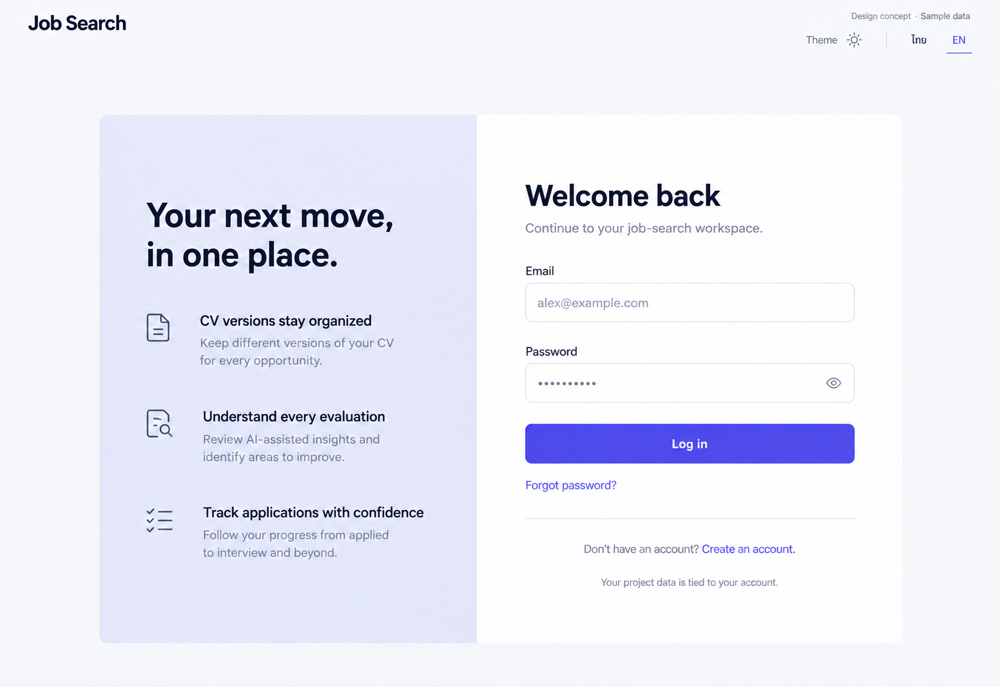

# 15 — Login

Date: 2026-10-17 (Asia/Bangkok). Version: v1. **Draft awaiting owner review. Not implemented.**

[Checklist](CODEX_PAGE_DESIGN_CHECKLIST.md) · [Shared visual system](01_OVERVIEW_DESIGN.md) · [Batch accessibility and state requirements](CODEX_PAGES_07_16_HANDOFF.md)

Generated design concept, synthetic English desktop/light content. This is not a browser screenshot or evidence of working behavior. Other language/theme/viewport states are specified, not generated or verified.

## Scope and existing implementation

Route: `/login`.

Reuse `frontend/src/features/auth/AuthPages.tsx (LoginPage, AuthShell); components/PasswordInput.tsx; lib/api.ts` (semicolon-separated entries identify related source files). Apply later in `/Users/parksurakiat/.codex/worktrees/ux-redesign-plan/AI-Job-Search-Agent-Platform-dem`, branch `feat/ux-core-workspaces`. Preserve all existing uncommitted work. This handoff authorizes no application changes during the image round.

## Regions and UI components

NO app sidebar. Public header wordmark Job Search left and Theme / ไทย EN right. Large whitespace, centered two-column authentication composition total width960. Left narrow brand context on very pale indigo flat background: Your next move, in one place. Three modest text rows CV versions stay organized; Understand every evaluation; Track applications with confidence. No illustration, no fake testimonial. Right unboxed 400px form: Welcome back heading, Continue to your job-search workspace. Email labeled input alex@example.com. Password labeled input masked and eye visibility button. Primary full-width Log in. Forgot password? link. Divider then Don't have an account? Create an account. Small privacy-style plain text Your project data is tied to your account, no nonfunctional policy link. Small Design concept · Sample data. No social login, magic link, remember me or provider icons.

Use the picture for composition and hierarchy; use `DESIGN.md` and existing primitives for actual tokens, spacing, typography, controls and icon family. Do not copy raster pixels, generated gradients, inconsistent button emphasis or incidental glyphs into production. Main content remains semantic HTML, not a background image.

## Behavior and preserved capabilities

Use existing email/password login helper, busy and localized error handling, session refresh and safe next redirect. Preserve allowed /app destination validation to prevent external redirects; never expose secrets or credentials in URLs. Use PasswordInput reveal control with accessible label and proper autocomplete email/current-password. Prevent duplicate submission, retain email on failure and show rate-limit/unverified/invalid-login feedback exactly as current error policy permits. Existing owner-session redirect must remain. Secondary links go to forgot-password and signup; do not add unsupported social auth.

## Data and API boundaries

Use existing login, refreshOwnerSession, useOwnerSession and safeNext from AuthPages/lib/api. Keep request schema, cookies/CSRF/session handling unchanged. Passwords are never stored in generic draft persistence, logs, fixtures committed with real credentials or image metadata.

Endpoint fragments above describe existing contracts; confirm exact methods, request fields and permission gates in the referenced source before implementation. Never introduce a backend endpoint to match an incidental image detail. All example counts, names, timestamps and badges must come from real scoped data in production.

## Image review notes

The left context column is static explanatory copy and collapses away before the form on narrow screens. Keep all error and account-gate recovery links in the form. No new authentication methods are implied.

Selected image corrects an earlier generated employer-feedback claim to “Review AI-assisted insights and identify areas to improve.” The earlier candidate is not the handoff reference. Keep this accurate AI-assisted wording and solid semantic primary button color.

## Bilingual labels

| English | Thai |
|---|---|
| Welcome back | ยินดีต้อนรับกลับ |
| Email | อีเมล |
| Password | รหัสผ่าน |
| Log in | เข้าสู่ระบบ |

Translate all remaining labels, accessible names and state messages using the current i18n namespaces. Preserve the same meaning and actions in both languages.

## States, responsive behavior and implementation acceptance

Follow the shared [batch requirements](CODEX_PAGES_07_16_HANDOFF.md). Keep loading, empty, error, busy/success and permission states; add running/approval/partial states wherever the real operation supports them. Preserve drafts on retriable failure, avoid duplicate writes and announce results accessibly.

For this page, verify the behaviors and contract boundaries listed above with existing synthetic fixtures and relevant Playwright journeys, including keyboard focus, long Thai content, mobile/tablet, English, light/dark, error recovery and supported URL state. Run frontend build/type checking after code changes. Compare actual screenshots to this concept and fix material defects. **These implementation tests have not been run for this image-only draft.**
