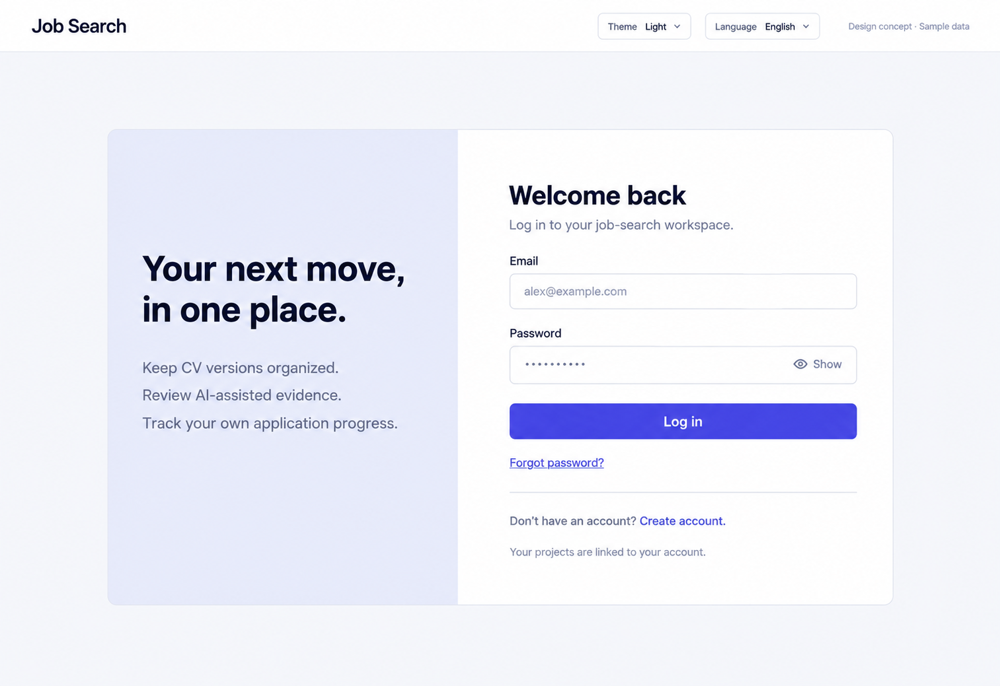

# 15 — Login · v2

Date: 2026-10-17 (Asia/Bangkok). **Review-led new concept; awaiting owner approval. Not implemented. Target10/10 is a quality goal, not an achieved score.**

[Current checklist](CODEX_PAGE_DESIGN_CHECKLIST.md) · [Round2 index and visual contract](CODEX_ALL_PAGES_REDESIGN_V2.md) · [Motion/pixel art specification](CODEX_PIXEL_MOTION_V2.md) · [Previous functional handoff](15_LOGIN_DESIGN.md)

Synthetic English desktop/light static concept. State pictured: **Login with consistent shared auth shell**. This is not a working website or an animated asset. Other variants/states remain required; this image does not prove mobile, dark, Thai, accessibility or end-to-end behavior.

## Visual and first-user intent

PUBLIC exactheader. Centered max960px two-column auth layout, left40% paleindigo staticcopy, right60% white form400px. Lefttitle Your next move, in one place. Three quietlines Keep CV versions organized; Review AI-assisted evidence; Track your own application progress. No testimonials,employerfeedback,illustrationorbigicons. Right Welcome back, subtitle Log in to your job-search workspace. Email emptyinput placeholder alex@example.com, Password maskedinput with labeledshoweye. Fullwidth solid Log in, Forgot password? link justbelow. Divider Don't have an account? Create account. Genericprivacycopy Your projects are linked to your account. No sociallogin,rememberme,magiclinksorfakepolicy links. Needpasswordsecurity visible properautocomplete notwrittenimplementationtext. Match Signup authframe,header,spacingexactly. Generouswhitespacewithoutgiantlefttext.

Use this composition and corrected copy for the new concept; source `DESIGN.md` remains the shipped UI authority. Flat semantic tokens and shared primitives win over accidental raster gradients, font/glyph inconsistencies or unsupported controls introduced by image generation. Standardize text-only wordmark, shared rail/header, action hierarchy and theme/language controls across every page.

## Functional scope and contracts — retained

The [previous handoff](15_LOGIN_DESIGN.md) retains this page's route, source files, API/schema details, all secondary tabs, forms, validation, drafts, error/retry, permission and asynchronous states. Read it before implementation. The new visual layout does not remove any of those capabilities. Earlier PNGs remain history, not the current visual target.

Use the existing React/Vite app and existing components, resource/API helpers and i18n. Never add a backend endpoint, change session/run/SSE/approval semantics, use the current primary CV as fallback provenance, or invent data fields to match a generated image. Any new grouping/selection presentation is frontend-only and must preserve supported URL state and project/account security boundaries.

Preserve source-authoritative upload/download behavior, immutable CV/job/document identities, partial documents, confirmations, busy/error recovery and keyboard navigation. Tracking updates never send applications. Authentication/consent/deletion retain existing credential, expiry, capability and safe-redirect rules. Original CV uploads and generated tailored documents are distinct resources.

## Motion specification — explanation only, no code

Field validation/success120–160ms and password revealinstant. No movementbehindform, no pixel art in authentication controls.

Animations are specified for Claude Code to implement later. Real operations alone drive progress/status; no timer invents progress or completion. Respect reduced motion, pause decorative motion when the tab is hidden, and avoid moving focused controls. No new animation library is required by this handoff. Use the shared [motion contract](CODEX_PIXEL_MOTION_V2.md) for durations, accessibility and performance limits.

## Pixel art and asset treatment

No pixel art in this page’s main workflow. Keep the shared outline icon family; do not add a mascot or animation behind forms, consent or destructive actions.

## Responsive, bilingual and state requirements

Follow shared requirements from [round1](CODEX_PAGES_07_16_HANDOFF.md) and [round2](CODEX_ALL_PAGES_REDESIGN_V2.md). Reuse the previous bilingual labels, correcting translations for any revised wording so Thai and English mean the same thing. Keep generated-document language separate from interface locale. Desktop columns collapse at tablet; mobile is one column with accessible navigation, wrapping actions, long-text handling and no page overflow. Never hide necessary decisions on mobile.

For new/empty users give a real next action without fake data. Preserve loaded content on partial resource failure; show contextual retry. Existing forms retain drafts on recoverable failure, prevent duplicate writes and announce outcomes. Never show success before server success, running while waiting for a person, or active access after expiry. Show unavailable provenance explicitly rather than guessing.

## Acceptance before implementation completion

Use synthetic fixtures with a frozen clock and coherent dates/statuses. Verify this page's main task plus all relevant pending, approval, partial, empty, invalid-token, permission and failure paths from the previous handoff. Build/type check and run relevant existing/new Playwright tests after actual code changes; inspect real desktop/tablet/mobile, Thai/English and light/dark screenshots, keyboard/focus and reduced-motion behavior. Impeccable review must distinguish concept review from runtime proof. No such implementation results are claimed in this image-only round.
