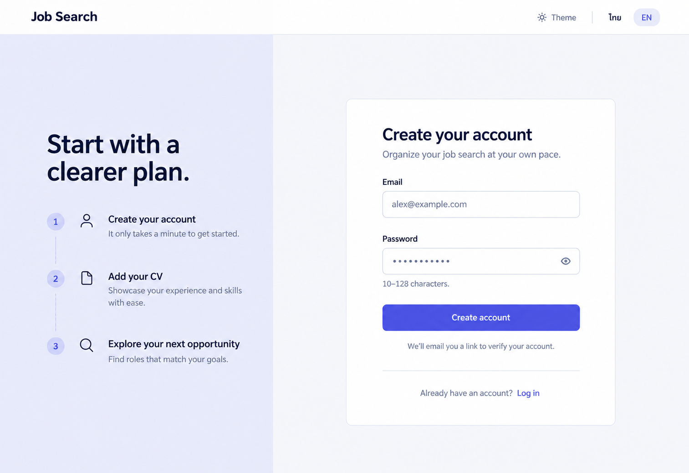

# 16 — Sign Up

Date: 2026-10-17 (Asia/Bangkok). Version: v1. **Draft awaiting owner review. Not implemented.**

[Checklist](CODEX_PAGE_DESIGN_CHECKLIST.md) · [Shared visual system](01_OVERVIEW_DESIGN.md) · [Batch accessibility and state requirements](CODEX_PAGES_07_16_HANDOFF.md)

Generated design concept, synthetic English desktop/light content. This is not a browser screenshot or evidence of working behavior. Other language/theme/viewport states are specified, not generated or verified.

## Scope and existing implementation

Route: `/signup`.

Reuse `frontend/src/features/auth/AuthPages.tsx (SignupPage, AuthShell); components/PasswordInput.tsx; lib/api.ts` (semicolon-separated entries identify related source files). Apply later in `/Users/parksurakiat/.codex/worktrees/ux-redesign-plan/AI-Job-Search-Agent-Platform-dem`, branch `feat/ux-core-workspaces`. Preserve all existing uncommitted work. This handoff authorizes no application changes during the image round.

## Regions and UI components

NO app rail. Public header Job Search left, Theme and ไทย/EN right. Same polished two-column auth composition as Login. Left pale indigo context panel heading Start with a clearer plan. Three quiet numbered lines Create your account; Add your CV; Explore your next opportunity. Right 400px form heading Create your account, subtitle Organize your job search at your own pace. Email labeled field alex@example.com. Password masked field with visibility eye; helper 10–128 characters. Primary Create account. Quiet next-step notice We'll email you a link to verify your account. Footer Already have an account? Log in. No name, confirm-password, social login, agreement checkbox, pricing, fake trust logos or animation. Crisp restrained realistic form.

Use the picture for composition and hierarchy; use `DESIGN.md` and existing primitives for actual tokens, spacing, typography, controls and icon family. Do not copy raster pixels, generated gradients, inconsistent button emphasis or incidental glyphs into production. Main content remains semantic HTML, not a background image.

## Behavior and preserved capabilities

Reuse signup(email.trim(), password, locale). Keep existing password limits 10–128 and email validation; do not invent mandatory name, confirmation, marketing consent or extra endpoints. Busy/double-submit prevention and localized field/server/rate-limit errors remain. Success changes to existing Check your email state with sign-in action, not an authenticated dashboard or fabricated delivery guarantee. Do not reveal whether an account exists beyond current backend policy. Form language is passed through existing locale argument. Password show/hide and autofill must be accessible.

## Data and API boundaries

Existing signup helper and session/error policy only. Preserve current signup response-to-sent-state behavior and email verification flow. No auto-login or unsupported provider login. Never persist password in generic drafts, tokens in URLs beyond existing verification link semantics or synthetic example values in real API calls.

Endpoint fragments above describe existing contracts; confirm exact methods, request fields and permission gates in the referenced source before implementation. Never introduce a backend endpoint to match an incidental image detail. All example counts, names, timestamps and badges must come from real scoped data in production.

## Image review notes

The image depicts the initial form only. The verification-email success view is still required. Password rules must match the actual backend rather than an invented strength score or additional complexity requirements.

Remove the generated time promise “It only takes a minute to get started”; use “Create an account to keep your search organized.” Match the Login page’s auth container geometry, spacing and shared Header rather than implementing two competing auth shells.

## Bilingual labels

| English | Thai |
|---|---|
| Create your account | สร้างบัญชีของคุณ |
| Create account | สร้างบัญชี |
| Check your email | ตรวจสอบอีเมลของคุณ |
| Already have an account? | มีบัญชีอยู่แล้ว? |

Translate all remaining labels, accessible names and state messages using the current i18n namespaces. Preserve the same meaning and actions in both languages.

## States, responsive behavior and implementation acceptance

Follow the shared [batch requirements](CODEX_PAGES_07_16_HANDOFF.md). Keep loading, empty, error, busy/success and permission states; add running/approval/partial states wherever the real operation supports them. Preserve drafts on retriable failure, avoid duplicate writes and announce results accessibly.

For this page, verify the behaviors and contract boundaries listed above with existing synthetic fixtures and relevant Playwright journeys, including keyboard focus, long Thai content, mobile/tablet, English, light/dark, error recovery and supported URL state. Run frontend build/type checking after code changes. Compare actual screenshots to this concept and fix material defects. **These implementation tests have not been run for this image-only draft.**
