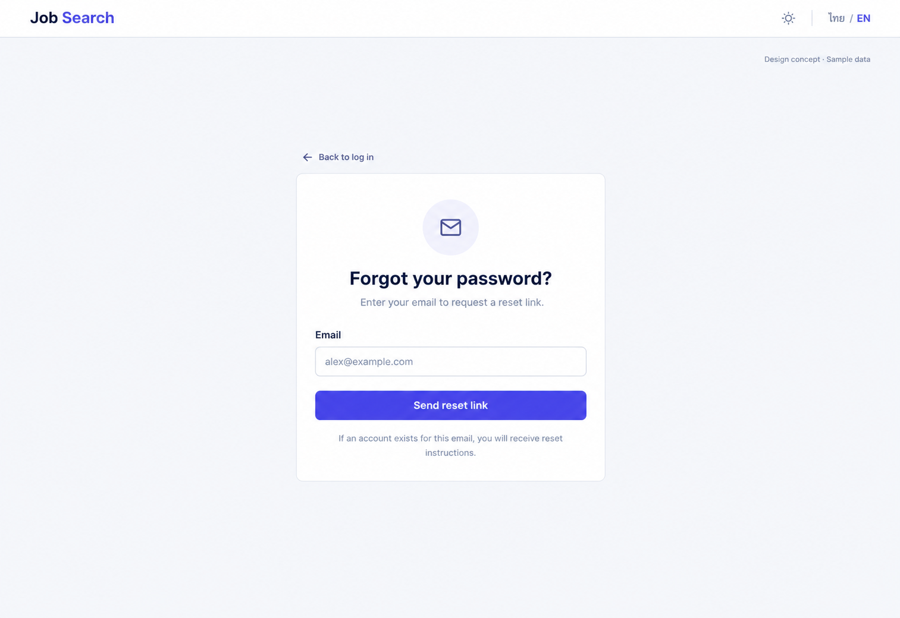

# 17 — Forgot Password

Date: 2026-10-17 (Asia/Bangkok). Version: v1. **Draft awaiting owner review. Not implemented.**

[Checklist](CODEX_PAGE_DESIGN_CHECKLIST.md) · [Complete handoff index](CODEX_ALL_PAGES_HANDOFF.md) · [Shared responsive/state requirements](CODEX_PAGES_07_16_HANDOFF.md)

Synthetic English desktop/light design concept, not a browser screenshot or functional verification. Other variants/states below are required later, not pictured or verified.

## Scope and source

Route: `/forgot-password`. Existing feature source: `frontend/src/features/auth/AuthPages.tsx (ForgotPasswordPage, AuthShell); components/PasswordInput.tsx; lib/api.ts`. Reuse source-authoritative helpers, localization, shared Header/shell and UI primitives. Implementation checkout: `/Users/parksurakiat/.codex/worktrees/ux-redesign-plan/AI-Job-Search-Agent-Platform-dem`, branch `feat/ux-core-workspaces`. Preserve existing uncommitted changes. No application code changes in this image round.

## Regions and UI components

NO project rail. Public Header Job Search wordmark left, theme icon and ไทย / EN right. Centered calm white single form width440px on neutral workspace, small back link Back to log in above. Title Forgot your password? Subtitle Enter your email to request a reset link. Email labeled field, placeholder alex@example.com. Solid primary full-width Send reset link. Quiet note If an account exists for this email, you will receive reset instructions. No social login, verification code, resend timer, fake delivery timestamp or marketing column. Subtle outlined mail icon, generous whitespace and readable body. Small Design concept · Sample data at top right. Form is main focus.

The image guides composition; `DESIGN.md` and existing components govern production tokens, font, controls and icon family. Use flat semantic colors, not incidental generated gradients. Keep all form content real HTML with programmatic labels; never render the UI as a background image.

## Behavior and states

Reuse ForgotPasswordPage useSubmit and forgotPassword(email.trim()). Initial email form transitions to existing Check your email state on successful request; preserve account-enumeration-safe messaging without guaranteeing actual delivery. Preserve loading, busy, request error/rate limit and back-to-login. Retain email for retries and prevent duplicate requests. No resend countdown or new recovery method.

## Data, security and existing contracts

Use existing forgotPassword helper and current API/session/error policy. Existing account-independent public route. No new endpoint, response field, email disclosure or stored password/token.

Confirm exact methods, payloads and error codes in existing source before coding. This handoff cannot expand API capabilities or change permissions. No real passwords, tokens, account emails or provider secrets are used by this concept.

## Image interpretation

Only the initial request form is pictured. The success view uses neutral account-enumeration-safe copy and never confirms that a specific email is registered. No delivery time is promised.

## Bilingual labels

| English | Thai |
|---|---|
| Forgot your password? | ลืมรหัสผ่าน? |
| Send reset link | ส่งลิงก์ตั้งรหัสผ่านใหม่ |
| Back to log in | กลับไปเข้าสู่ระบบ |
| Check your email | ตรวจสอบอีเมลของคุณ |

Localize all remaining labels, errors, hints and accessible names with the existing i18n system. Do not change document language or user content when switching UI language.

## Responsive and accessibility requirements

Reuse the [shared requirements](CODEX_PAGES_07_16_HANDOFF.md): semantic landmarks/headings, visible keyboard focus, labels/autocomplete, accessible password reveal, errors linked to fields, busy/success announcements and dialog focus restoration where relevant. Public forms stay narrow/readable on desktop and fit one column on mobile without overflow. Global rail collapses using existing shell behavior. Support long Thai text, English and semantic light/dark/system tokens. Never infer actual accessibility conformance from this PNG.

## Later acceptance and verification

Use synthetic fixtures to cover the normal flow and each supported busy/error/invalid-token/permission/empty/success state above. Verify no duplicate request, safe redirects, password handling and authorization boundaries where relevant. Run frontend build/type checking and relevant existing/new Playwright journeys after implementation; capture real desktop/tablet/mobile screenshots in Thai/English and light/dark, test keyboard behavior and perform Impeccable finish review. Do not weaken tests or require real provider credentials. **No such application tests were run for this image-only draft.**
