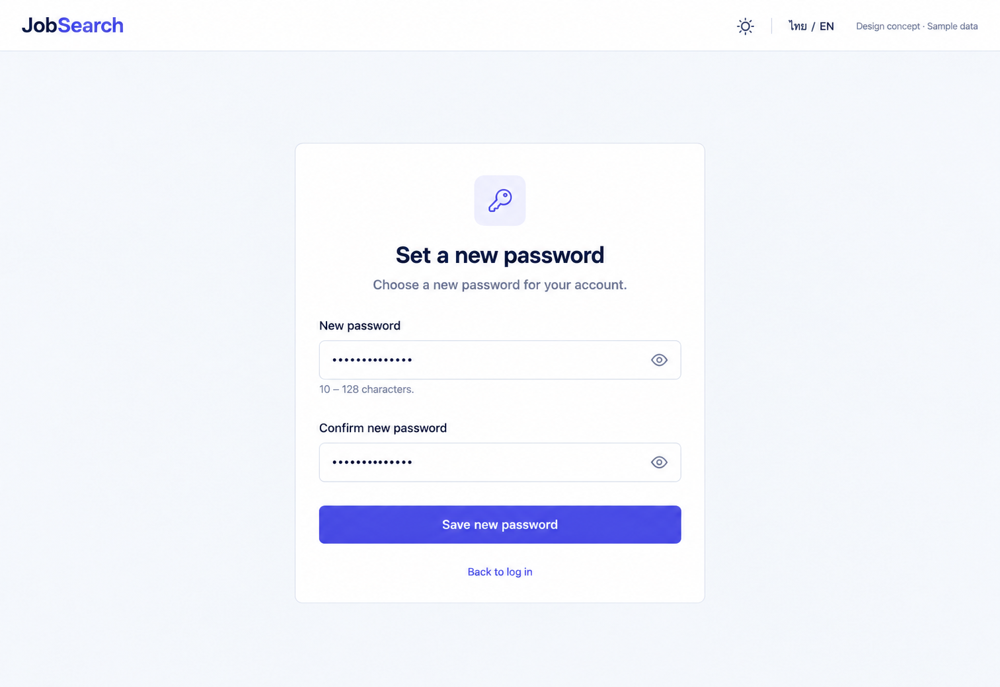

# 18 — Reset Password

Date: 2026-10-17 (Asia/Bangkok). Version: v1. **Draft awaiting owner review. Not implemented.**

[Checklist](CODEX_PAGE_DESIGN_CHECKLIST.md) · [Complete handoff index](CODEX_ALL_PAGES_HANDOFF.md) · [Shared responsive/state requirements](CODEX_PAGES_07_16_HANDOFF.md)

Synthetic English desktop/light design concept, not a browser screenshot or functional verification. Other variants/states below are required later, not pictured or verified.

## Scope and source

Route: `/reset-password`. Existing feature source: `frontend/src/features/auth/AuthPages.tsx (ResetPasswordPage, useUrlToken); components/PasswordInput.tsx; lib/api.ts`. Reuse source-authoritative helpers, localization, shared Header/shell and UI primitives. Implementation checkout: `/Users/parksurakiat/.codex/worktrees/ux-redesign-plan/AI-Job-Search-Agent-Platform-dem`, branch `feat/ux-core-workspaces`. Preserve existing uncommitted changes. No application code changes in this image round.

## Regions and UI components

NO rail. Public Header Job Search, theme and ไทย/EN. Centered flat white form width460px. Heading Set a new password. Subtitle Choose a new password for your account. Labeled New password masked input with accessible eye button and hint 10–128 characters. Labeled Confirm new password masked input and eye button. Solid indigo full-width Save new password. Quiet link Back to log in. Calm space, restrained line icon key. Small Design concept · Sample data. No email entry, strength meter, complexity checklist, token value, success state simultaneously, social login or extra fields.

The image guides composition; `DESIGN.md` and existing components govern production tokens, font, controls and icon family. Use flat semantic colors, not incidental generated gradients. Keep all form content real HTML with programmatic labels; never render the UI as a background image.

## Behavior and states

Preserve token extraction/scrubbing behavior in useUrlToken, new-password autocomplete, length10–128, confirmation matching, busy/duplicate protection, accessible mismatch and backend errors. No token displays existing invalid-link state with Request a new link to forgot-password. Valid success displays saved status and Log in action; never auto-login. Retain local entries on retry but never generic persisted drafts.

## Data, security and existing contracts

Reuse resetPassword(token,password) and existing token helper. Keep existing request schema and invalid/expired-token/error behavior. Token must not appear in screenshot sample data, metadata, analytics or UI. No backend complexity rules invented.

Confirm exact methods, payloads and error codes in existing source before coding. This handoff cannot expand API capabilities or change permissions. No real passwords, tokens, account emails or provider secrets are used by this concept.

## Image interpretation

The selected image corrects an earlier generated header with unsupported job-board/employer navigation. Use the shared public Header, not the rejected candidate. Error, missing-token and completed states are not pictured.

## Bilingual labels

| English | Thai |
|---|---|
| Set a new password | ตั้งรหัสผ่านใหม่ |
| New password | รหัสผ่านใหม่ |
| Confirm new password | ยืนยันรหัสผ่านใหม่ |
| Save new password | บันทึกรหัสผ่านใหม่ |

Localize all remaining labels, errors, hints and accessible names with the existing i18n system. Do not change document language or user content when switching UI language.

## Responsive and accessibility requirements

Reuse the [shared requirements](CODEX_PAGES_07_16_HANDOFF.md): semantic landmarks/headings, visible keyboard focus, labels/autocomplete, accessible password reveal, errors linked to fields, busy/success announcements and dialog focus restoration where relevant. Public forms stay narrow/readable on desktop and fit one column on mobile without overflow. Global rail collapses using existing shell behavior. Support long Thai text, English and semantic light/dark/system tokens. Never infer actual accessibility conformance from this PNG.

## Later acceptance and verification

Use synthetic fixtures to cover the normal flow and each supported busy/error/invalid-token/permission/empty/success state above. Verify no duplicate request, safe redirects, password handling and authorization boundaries where relevant. Run frontend build/type checking and relevant existing/new Playwright journeys after implementation; capture real desktop/tablet/mobile screenshots in Thai/English and light/dark, test keyboard behavior and perform Impeccable finish review. Do not weaken tests or require real provider credentials. **No such application tests were run for this image-only draft.**
