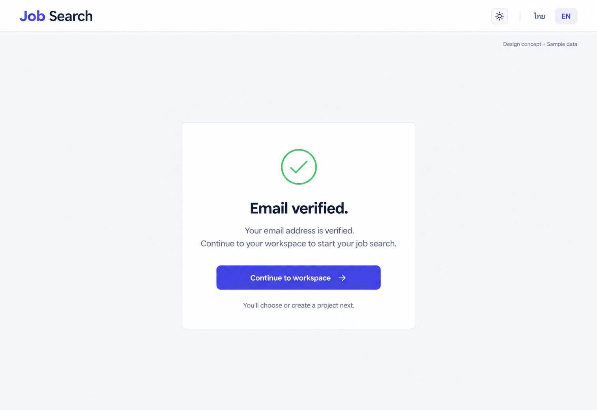

# 19 — Verify Email

Date: 2026-10-17 (Asia/Bangkok). Version: v1. **Draft awaiting owner review. Not implemented.**

[Checklist](CODEX_PAGE_DESIGN_CHECKLIST.md) · [Complete handoff index](CODEX_ALL_PAGES_HANDOFF.md) · [Shared responsive/state requirements](CODEX_PAGES_07_16_HANDOFF.md)

Synthetic English desktop/light design concept, not a browser screenshot or functional verification. Other variants/states below are required later, not pictured or verified.

## Scope and source

Route: `/verify-email`. Existing feature source: `frontend/src/features/auth/AuthPages.tsx (VerifyEmailPage, useUrlToken); lib/api.ts`. Reuse source-authoritative helpers, localization, shared Header/shell and UI primitives. Implementation checkout: `/Users/parksurakiat/.codex/worktrees/ux-redesign-plan/AI-Job-Search-Agent-Platform-dem`, branch `feat/ux-core-workspaces`. Preserve existing uncommitted changes. No application code changes in this image round.

## Regions and UI components

NO rail. Public Job Search Header theme and ไทย/EN. Centered restrained white outcome panel width480px, modest green outlined circle check icon, heading Email verified. Body Your email address is verified. Continue to your workspace to start your job search. Primary indigo Continue to workspace. Small note You'll choose or create a project next. Small Design concept · Sample data top right. Success state only, no account email or personal data, no marketing banner, confetti, token value, fake automatic redirect countdown or resend verification button.

The image guides composition; `DESIGN.md` and existing components govern production tokens, font, controls and icon family. Use flat semantic colors, not incidental generated gradients. Keep all form content real HTML with programmatic labels; never render the UI as a background image.

## Behavior and states

Image pictures completed verification only. Preserve initial working status, missing/invalid/expired token error, retry through existing supported recovery and login link. Verify effect is guarded against duplicate invocation. Existing verifyEmail(token), refreshOwnerSession and Continue navigation to /app remain; do not assert user is signed in solely because verification succeeded. Existing /app session gate chooses next destination. No fabricated automatic redirect/resend helper.

## Data, security and existing contracts

Existing verifyEmail(token), refreshOwnerSession and useUrlToken semantics; success state only after server success. No new account-info read or unsupported verification endpoint. Never expose token in UI, logs, screenshots or handoff fixtures.

Confirm exact methods, payloads and error codes in existing source before coding. This handoff cannot expand API capabilities or change permissions. No real passwords, tokens, account emails or provider secrets are used by this concept.

## Image interpretation

Verification success is not login success. Replace the generated next-project promise with “Continue to the app; sign in if prompted” unless the actual session is confirmed and the next destination is known. Never display success before the verification call succeeds.

## Bilingual labels

| English | Thai |
|---|---|
| Email verified | ยืนยันอีเมลแล้ว |
| Continue to workspace | ไปยังพื้นที่ทำงาน |
| Verifying email | กำลังยืนยันอีเมล |
| This link is invalid or expired | ลิงก์ไม่ถูกต้องหรือหมดอายุ |

Localize all remaining labels, errors, hints and accessible names with the existing i18n system. Do not change document language or user content when switching UI language.

## Responsive and accessibility requirements

Reuse the [shared requirements](CODEX_PAGES_07_16_HANDOFF.md): semantic landmarks/headings, visible keyboard focus, labels/autocomplete, accessible password reveal, errors linked to fields, busy/success announcements and dialog focus restoration where relevant. Public forms stay narrow/readable on desktop and fit one column on mobile without overflow. Global rail collapses using existing shell behavior. Support long Thai text, English and semantic light/dark/system tokens. Never infer actual accessibility conformance from this PNG.

## Later acceptance and verification

Use synthetic fixtures to cover the normal flow and each supported busy/error/invalid-token/permission/empty/success state above. Verify no duplicate request, safe redirects, password handling and authorization boundaries where relevant. Run frontend build/type checking and relevant existing/new Playwright journeys after implementation; capture real desktop/tablet/mobile screenshots in Thai/English and light/dark, test keyboard behavior and perform Impeccable finish review. Do not weaken tests or require real provider credentials. **No such application tests were run for this image-only draft.**
