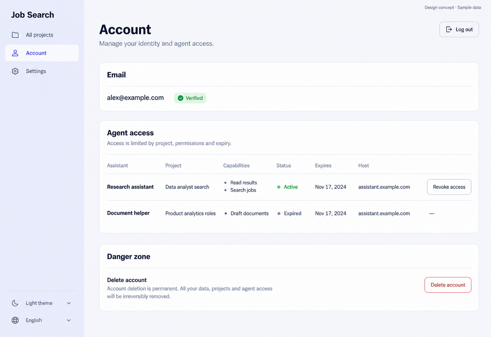

# 20 — Account

Date: 2026-10-17 (Asia/Bangkok). Version: v1. **Draft awaiting owner review. Not implemented.**

[Checklist](CODEX_PAGE_DESIGN_CHECKLIST.md) · [Complete handoff index](CODEX_ALL_PAGES_HANDOFF.md) · [Shared responsive/state requirements](CODEX_PAGES_07_16_HANDOFF.md)

Synthetic English desktop/light design concept, not a browser screenshot or functional verification. Other variants/states below are required later, not pictured or verified.

## Scope and source

Route: `/app/account`. Existing feature source: `frontend/src/features/account/AccountPage.tsx; lib/api.ts`. Reuse source-authoritative helpers, localization, shared Header/shell and UI primitives. Implementation checkout: `/Users/parksurakiat/.codex/worktrees/ux-redesign-plan/AI-Job-Search-Agent-Platform-dem`, branch `feat/ux-core-workspaces`. Preserve existing uncommitted changes. No application code changes in this image round.

## Regions and UI components

Use GLOBAL rail only Job Search wordmark, All projects, Account selected, Settings, bottom theme and language. Main width850px heading Account, subtitle Manage your identity and agent access, outlined Log out top right. Simple Email section showing alex@example.com with Verified green badge. Agent access section with help Access is limited by project, permissions and expiry. Two flat rows: Research assistant, Data analyst search, capabilities Read results and Search jobs, Active, Expires Nov17, Revoke access outline; Document helper, Product analytics roles, Draft documents, Expired, no revoke. Small host helper assistant.example.com where relevant. Quiet separated bottom Danger zone, Delete account with subdued red outline button and clear Account deletion is permanent explanatory copy. No subscription plan, password-change form, avatar uploader, billing or fake security score. Small Design concept · Sample data.

The image guides composition; `DESIGN.md` and existing components govern production tokens, font, controls and icon family. Use flat semantic colors, not incidental generated gradients. Keep all form content real HTML with programmatic labels; never render the UI as a background image.

## Behavior and states

Preserve account email verified/unverified status and conditional resendVerification with busy/sent/error feedback. Agent list uses actual account agents, project identity, client host, capabilities, expiry and revoked state; active grants alone can be revoked. Preserve404-idempotent handling and reloading. Log out uses existing helper. Delete account remains an explicit destructive dialog requiring current password and matching email, cancellation/focus management and existing rate/invalid-credential errors. Never make delete one click; preserve full reload to public root after actual server success.

## Data, security and existing contracts

useAccount; GET /account/agents; existing DELETE /projects/{projectId}/grants/{grantId}; resendVerification, logout, deleteAccount(password,confirmEmail) helpers. Existing owner/account authorization unchanged. Password/confirmation drafts remain local to dialog and are never generically persisted.

Confirm exact methods, payloads and error codes in existing source before coding. This handoff cannot expand API capabilities or change permissions. No real passwords, tokens, account emails or provider secrets are used by this concept.

## Image interpretation

The image contains generated example expiry dates inconsistent with an Active badge in the current date context. Fixtures must use a frozen reference clock with future/expired dates that match status. Use source-authoritative account-deletion consequences, not expanded generated claims about data removal beyond the existing contract.

## Bilingual labels

| English | Thai |
|---|---|
| Account | บัญชี |
| Agent access | สิทธิ์เข้าถึงของเอเจนต์ |
| Revoke access | เพิกถอนสิทธิ์ |
| Delete account | ลบบัญชี |

Localize all remaining labels, errors, hints and accessible names with the existing i18n system. Do not change document language or user content when switching UI language.

## Responsive and accessibility requirements

Reuse the [shared requirements](CODEX_PAGES_07_16_HANDOFF.md): semantic landmarks/headings, visible keyboard focus, labels/autocomplete, accessible password reveal, errors linked to fields, busy/success announcements and dialog focus restoration where relevant. Public forms stay narrow/readable on desktop and fit one column on mobile without overflow. Global rail collapses using existing shell behavior. Support long Thai text, English and semantic light/dark/system tokens. Never infer actual accessibility conformance from this PNG.

## Later acceptance and verification

Use synthetic fixtures to cover the normal flow and each supported busy/error/invalid-token/permission/empty/success state above. Verify no duplicate request, safe redirects, password handling and authorization boundaries where relevant. Run frontend build/type checking and relevant existing/new Playwright journeys after implementation; capture real desktop/tablet/mobile screenshots in Thai/English and light/dark, test keyboard behavior and perform Impeccable finish review. Do not weaken tests or require real provider credentials. **No such application tests were run for this image-only draft.**
