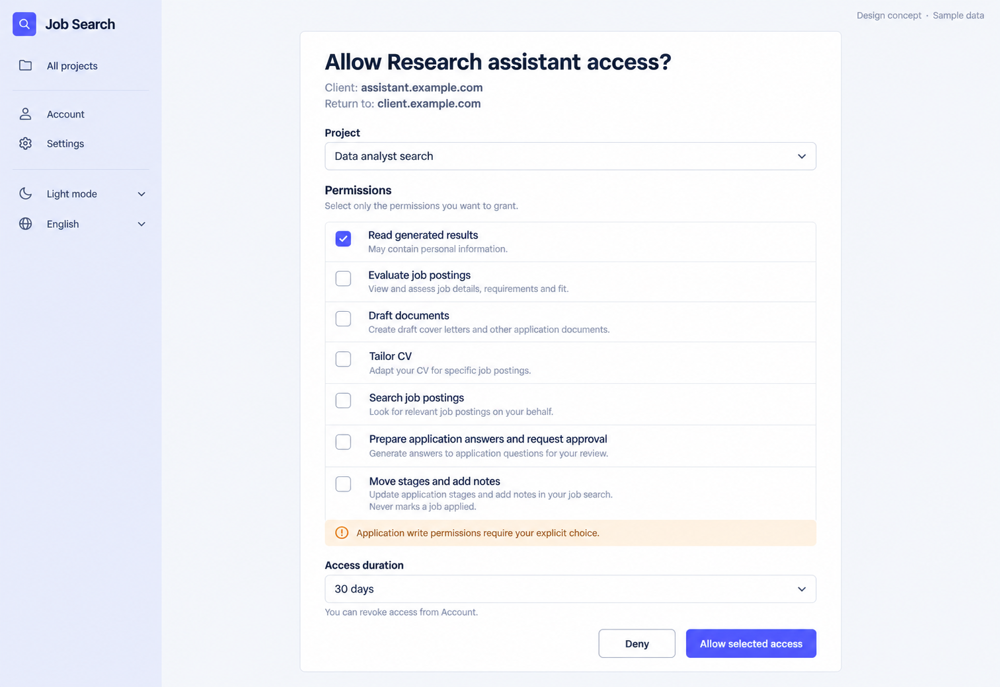

# 21 — OAuth Consent

Date: 2026-10-17 (Asia/Bangkok). Version: v1. **Draft awaiting owner review. Not implemented.**

[Checklist](CODEX_PAGE_DESIGN_CHECKLIST.md) · [Complete handoff index](CODEX_ALL_PAGES_HANDOFF.md) · [Shared responsive/state requirements](CODEX_PAGES_07_16_HANDOFF.md)

Synthetic English desktop/light design concept, not a browser screenshot or functional verification. Other variants/states below are required later, not pictured or verified.

## Scope and source

Route: `/app/oauth/consent`. Existing feature source: `frontend/src/features/oauth/ConsentPage.tsx; settings capability localization; lib/api.ts`. Reuse source-authoritative helpers, localization, shared Header/shell and UI primitives. Implementation checkout: `/Users/parksurakiat/.codex/worktrees/ux-redesign-plan/AI-Job-Search-Agent-Platform-dem`, branch `feat/ux-core-workspaces`. Preserve existing uncommitted changes. No application code changes in this image round.

## Regions and UI components

Use compact GLOBAL rail Job Search, All projects, Account, Settings, theme/language, no project navigation. Centered white consent panel width700px heading Allow Research assistant access? Origin text Client: assistant.example.com and Return to: client.example.com clearly visible. Project dropdown Data analyst search. Permissions section seven compact checkbox rows: Read generated results checked, with helper May contain personal information; Evaluate job postings unchecked; Draft documents unchecked; Tailor CV unchecked; Search job postings unchecked; Prepare application answers and request approval unchecked; Move stages and add notes unchecked, helper Never marks a job applied. Small quiet helper Select only the permissions you want to grant. Subtle warning below last two Application write permissions require your explicit choice. Access duration dropdown 30 days with hint You can revoke access from Account. Footer equally legible Allow selected access solid indigo, Deny outlined. No verified badge, trusted app logo, prechecked application write permission, hidden capabilities or fake connection success. Small Design concept · Sample data.

The image guides composition; `DESIGN.md` and existing components govern production tokens, font, controls and icon family. Use flat semantic colors, not incidental generated gradients. Keep all form content real HTML with programmatic labels; never render the UI as a background image.

## Behavior and states

Preserve request handle lookup, client identity/redirect host, authorized project choices, all7 existing capability options, expiry7/30/90days and allow/deny submission. Defaults match existing requested-scope logic excluding applications:apply and applications:write; image sample checks only results:read, not a new default policy. No projects offers existing Create project route. Missing/404/expired request shows existing recovery, error retry/busy remain. Preserve encoded request handle and blocked unsafe redirect schemes while allowing current HTTPS/loopback/native application redirects. Permission labels must honestly explain existing application capability semantics; this concept never adds automatic submission.

## Data, security and existing contracts

GET /oauth/requests/{encodedRequest}; POST /approve with {project_id,capabilities,expires_at} or POST /deny with existing empty body, all under same request route. Navigate only after existing navigableRedirect validation of redirect_url. Capability list and server limits unchanged. Never precheck applications:apply or applications:write or invent verified publisher evidence.

Confirm exact methods, payloads and error codes in existing source before coding. This handoff cannot expand API capabilities or change permissions. No real passwords, tokens, account emails or provider secrets are used by this concept.

## Image interpretation

Use the exact existing localized capability meanings. In particular applications:apply means prepare answers and request approval, while applications:write moves stages/adds notes and never marks applied. The displayed sample choices do not redefine server scope defaults. Keep Deny visible, do not imply publisher verification.

## Bilingual labels

| English | Thai |
|---|---|
| Allow selected access | อนุญาตสิทธิ์ที่เลือก |
| Deny | ไม่อนุญาต |
| Access duration | ระยะเวลาให้สิทธิ์ |
| Permissions | สิทธิ์ที่อนุญาต |

Localize all remaining labels, errors, hints and accessible names with the existing i18n system. Do not change document language or user content when switching UI language.

## Responsive and accessibility requirements

Reuse the [shared requirements](CODEX_PAGES_07_16_HANDOFF.md): semantic landmarks/headings, visible keyboard focus, labels/autocomplete, accessible password reveal, errors linked to fields, busy/success announcements and dialog focus restoration where relevant. Public forms stay narrow/readable on desktop and fit one column on mobile without overflow. Global rail collapses using existing shell behavior. Support long Thai text, English and semantic light/dark/system tokens. Never infer actual accessibility conformance from this PNG.

## Later acceptance and verification

Use synthetic fixtures to cover the normal flow and each supported busy/error/invalid-token/permission/empty/success state above. Verify no duplicate request, safe redirects, password handling and authorization boundaries where relevant. Run frontend build/type checking and relevant existing/new Playwright journeys after implementation; capture real desktop/tablet/mobile screenshots in Thai/English and light/dark, test keyboard behavior and perform Impeccable finish review. Do not weaken tests or require real provider credentials. **No such application tests were run for this image-only draft.**
