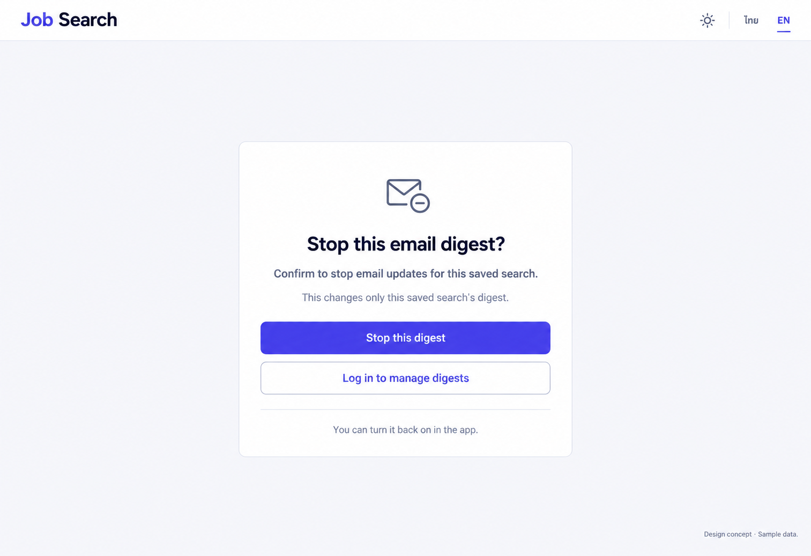

# 22 — Digest Unsubscribe

Date: 2026-10-17 (Asia/Bangkok). Version: v1. **Draft awaiting owner review. Not implemented.**

[Checklist](CODEX_PAGE_DESIGN_CHECKLIST.md) · [Complete handoff index](CODEX_ALL_PAGES_HANDOFF.md) · [Shared responsive/state requirements](CODEX_PAGES_07_16_HANDOFF.md)

Synthetic English desktop/light design concept, not a browser screenshot or functional verification. Other variants/states below are required later, not pictured or verified.

## Scope and source

Route: `/digest/unsubscribe`. Existing feature source: `frontend/src/features/digest/UnsubscribePage.tsx; lib/api.ts`. Reuse source-authoritative helpers, localization, shared Header/shell and UI primitives. Implementation checkout: `/Users/parksurakiat/.codex/worktrees/ux-redesign-plan/AI-Job-Search-Agent-Platform-dem`, branch `feat/ux-core-workspaces`. Preserve existing uncommitted changes. No application code changes in this image round.

## Regions and UI components

NO rail. Simple public Header Job Search wordmark, theme icon and ไทย/EN. Centered white confirmation panel width460px, small outlined mail-minus icon. Heading Stop this email digest? Body Confirm to stop email updates for this saved search. Quiet helper This changes only this saved search's digest. Solid indigo Stop this digest button. Secondary outlined Log in to manage digests link. Small note You can turn it back on in the app. Small Design concept · Sample data. Do NOT show successful unsubscribed status before click. No subscriber email, token, invented saved-search title, global unsubscribe toggle, delete-account controls, countdown, distressing red alert or fake marketing persuasion.

The image guides composition; `DESIGN.md` and existing components govern production tokens, font, controls and icon family. Use flat semantic colors, not incidental generated gradients. Keep all form content real HTML with programmatic labels; never render the UI as a background image.

## Behavior and states

Preserve explicit confirmation before unsubscribe request, idle/busy/done/expired/error states. Success states only this saved search's digest stopped with existing re-enable-in-app explanation. Missing token transitions to existing expired state on confirmation; HTTP400/404/422 are expired, other failure offers retry. Optional Log in action uses existing /login route and never blocks token-based unsubscribe behind authentication. This must not disable all account notifications or delete saved search/account.

## Data, security and existing contracts

Existing unsubscribeDigest(token) helper; current token query handling and status mappings unchanged. No new scope, automatic POST on page load, personal-data lookup or global subscription endpoint. Token stays out of screenshot, metadata and logs.

Confirm exact methods, payloads and error codes in existing source before coding. This handoff cannot expand API capabilities or change permissions. No real passwords, tokens, account emails or provider secrets are used by this concept.

## Image interpretation

A link to login is optional navigation, not a prerequisite for token-based unsubscribe. Keep the confirmation action primary. The current source does not expose a saved-search name here: do not infer or invent one from token content. No global notifications change is implied.

## Bilingual labels

| English | Thai |
|---|---|
| Stop this email digest? | หยุดรับอีเมลสรุปนี้? |
| Stop this digest | หยุดรับสรุปนี้ |
| Log in to manage digests | เข้าสู่ระบบเพื่อจัดการอีเมลสรุป |
| This link has expired | ลิงก์นี้หมดอายุแล้ว |

Localize all remaining labels, errors, hints and accessible names with the existing i18n system. Do not change document language or user content when switching UI language.

## Responsive and accessibility requirements

Reuse the [shared requirements](CODEX_PAGES_07_16_HANDOFF.md): semantic landmarks/headings, visible keyboard focus, labels/autocomplete, accessible password reveal, errors linked to fields, busy/success announcements and dialog focus restoration where relevant. Public forms stay narrow/readable on desktop and fit one column on mobile without overflow. Global rail collapses using existing shell behavior. Support long Thai text, English and semantic light/dark/system tokens. Never infer actual accessibility conformance from this PNG.

## Later acceptance and verification

Use synthetic fixtures to cover the normal flow and each supported busy/error/invalid-token/permission/empty/success state above. Verify no duplicate request, safe redirects, password handling and authorization boundaries where relevant. Run frontend build/type checking and relevant existing/new Playwright journeys after implementation; capture real desktop/tablet/mobile screenshots in Thai/English and light/dark, test keyboard behavior and perform Impeccable finish review. Do not weaken tests or require real provider credentials. **No such application tests were run for this image-only draft.**
