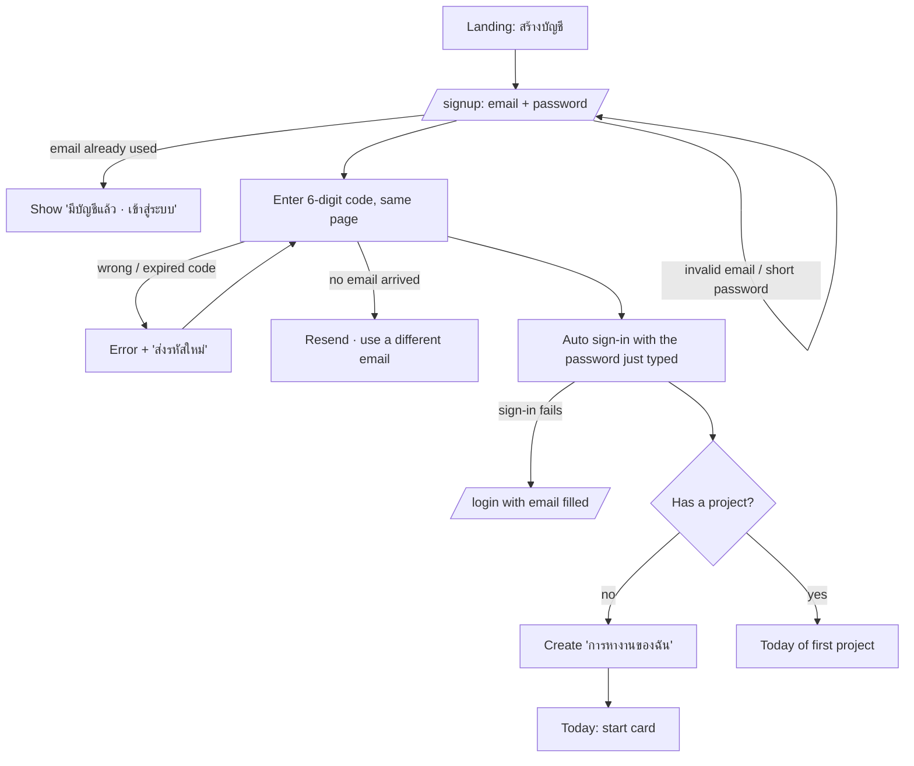
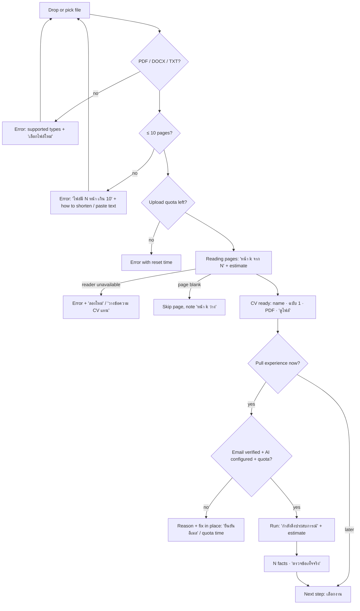
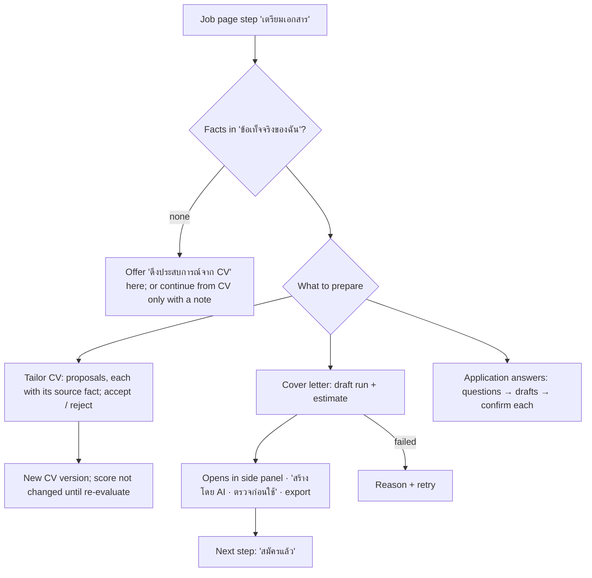
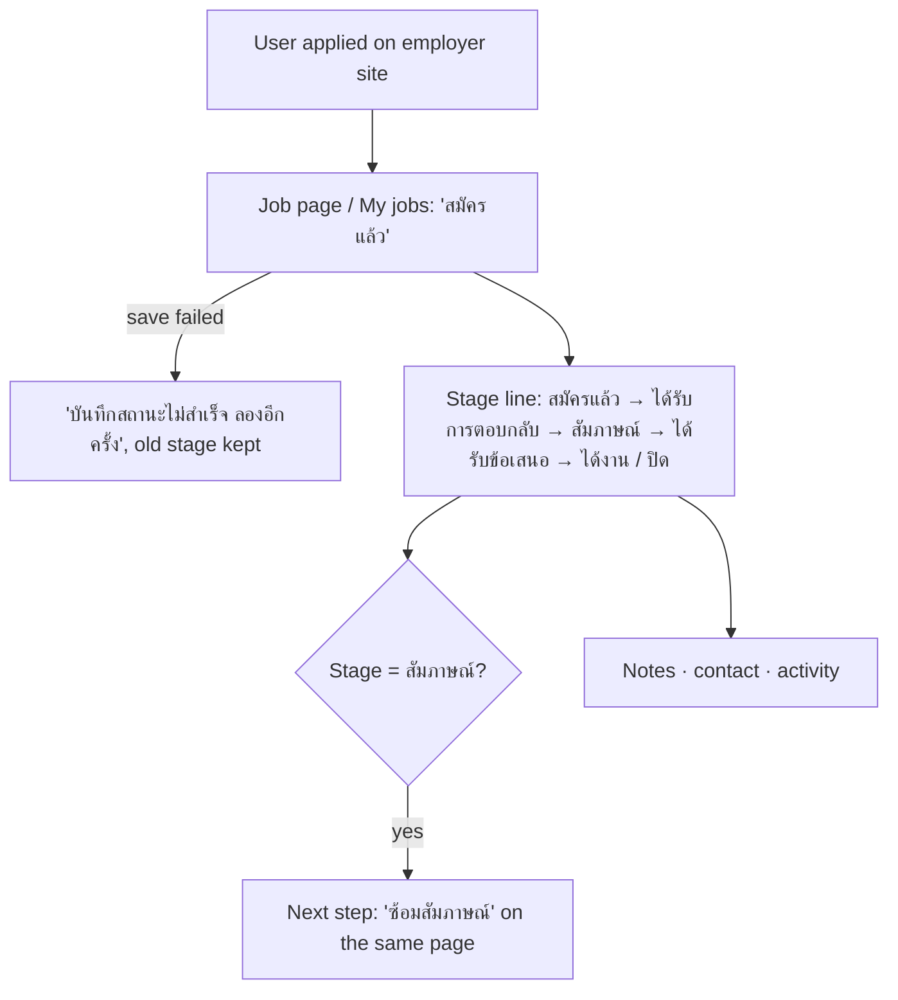
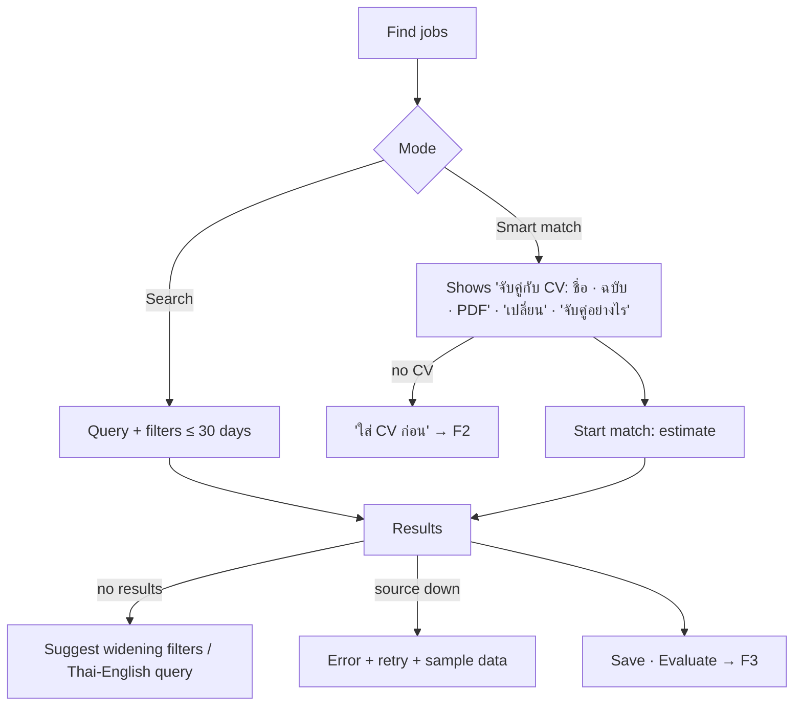

# Proposal: User Journey and User Flow, as-is → to-be

Status: **proposal, waiting for owner decision** (2026-11-04). Nothing here is built yet.
Evaluator: the owner first (on local), then the customer (on prod). No real users yet, so personas
stay hypotheses (P1, P2 in `ux-foundation.md`); the owner walkthrough script in §7 replaces user tests for now.
Code facts read on `develop` at `6373b9d`. Change IDs: CH-xx. Pain points: PP-xx from `ux-foundation.md`.

## 1. Biggest structural problems found (as-is)

| # | Problem | Evidence |
|---|---|---|
| S1 | **One job has two pages.** Job detail (`/jobs/:id`: description, evaluation, documents, tracking) and the session (`/sessions/:id`: evaluation, documents, application answers, practice). Both show the evaluation and documents; the user cannot tell which one is "the job". | `router.tsx`, `JobsPage.tsx` (h2 evaluation, related documents), `SessionPage.tsx` tabs |
| S2 | **First run has dead ends.** Sign up → enter code → sent to `/login` to sign in again → no project → empty project list → name a project → Today. 4 screens before anything useful. | `AuthPages.tsx:160` (`navigate('/login?notice=verified')`), `router.tsx` `AppStart` |
| S3 | **Two models of "my experience".** CV (used for the score) and experience bank (used for documents) live on one page with no explanation of who uses which. | UXR-04, PP-05, PP-09 |
| S4 | **Waiting without context.** Reading a CV (~10 s) and AI runs (evaluate, draft) show a spinner/status with no step list or time estimate. | PP-04, PP-08 |
| S5 | **Gates are silent.** AI buttons are disabled until email is verified; the reason is only a tooltip-like title. | `lib/accountGate.ts`, PP-01 |

## 2. To-be principles

1. **One job = one page.** Everything about a job (posting, score, documents, answers, practice, application status) lives on one job page with a visible progress line.
2. **First value in one sitting.** From sign-up to first fit score without leaving a guided path, no naming of projects, no second login.
3. **Say what the system uses.** Every AI result states its input ("คิดจาก CV: ชื่อ · ฉบับ").
4. **No silent waits or gates.** Every wait shows steps and an estimate; every block says why and offers the fix in place.
5. **Keep the nav at 5 items** (Today, Find jobs, My jobs, CV, Documents) and the click budgets in `ux-budget.spec.ts`.

## 3. To-be journeys

### J1 — First time (P1): sign up → first fit score

| Stage | To-be action | Screen | Change |
|---|---|---|---|
| 1 Arrive | Landing → "สร้างบัญชี" | Landing | — |
| 2 Sign up + verify | Email, password, then the 6-digit code on the same page → **signed in automatically** | `/signup` | CH-01 |
| 3 Workspace | First project "การหางานของฉัน" is created for you; you land on Today | Today | CH-02 |
| 4 Add CV | Today shows a 3-step start card: ① ใส่ CV ② เลือกงาน ③ ดูคะแนน. Drop the file on the card; it shows "กำลังอ่านหน้า 2 จาก 3" then "อ่านแล้ว 3 หน้า" with "ดูไฟล์" | Today (start card) | CH-03, CH-06 |
| 5 Pick a job | Step ② offers two ways: search jobs, or paste a posting (text or link) | Today → Find jobs, or paste dialog | CH-04 |
| 6 First score | One click "ประเมิน" → the job page opens on the score step, shows steps + estimate while waiting | Job page | CH-05, CH-06 |
| 7 Understand | Score with "คิดจาก CV: …" and a "ทำไมได้เท่านี้" section; next step suggested (ร่างจดหมาย) | Job page | CH-07 |

Target: sign-up to first score in **≤ 5 screens and ≤ 6 clicks** (excluding typing and AI wait). As-is: 8+ screens.

### J2 — Returning (P2): search → evaluate → prepare → apply → follow up

| Stage | To-be action | Screen | Change |
|---|---|---|---|
| 1 Come back | Today: next step for the most recent job, stats, jobs in progress | Today | — |
| 2 Search | Find jobs; the CV used for matching is shown with "ใช้ CV นี้จับคู่ · เปลี่ยน" and "จับคู่อย่างไร" | Find jobs | CH-07, CH-11 |
| 3 Evaluate | "ประเมิน" on a card → job page | Job page | CH-05 |
| 4 Tailor CV | Job page step "เตรียมเอกสาร": tailor CV and draft letter side by side; if the fact list is empty, "ดึงประสบการณ์จาก CV" is offered right there | Job page | CH-08 |
| 5 Read draft | Draft opens inside the job page (side panel), export from there | Job page | CH-09 |
| 6 Apply (outside) | Employer site | — | — |
| 7 Record | "สมัครแล้ว" on the job page progress line (1 click) | Job page / My jobs | — |
| 8 Follow up | Stage, notes, practice appear as later steps on the same page | Job page | CH-13 |

## 4. Information architecture (to-be)

```
Public: Landing · Features · How it works · Data · Manual · Log in / Sign up
App (one project selected; first project auto-created)
├── วันนี้ (Today)          start card (first run) · next step · stats · jobs in progress
├── หางาน (Find jobs)       search / smart match · filters · saved searches
├── งานของฉัน (My jobs)     list / board by application stage
│     └── หน้างาน (Job page)  ← merges Job detail + Session
│           progress: ประเมิน → เตรียมเอกสาร → สมัคร → สัมภาษณ์
│           panels: ประกาศงาน · ผลประเมิน · เอกสาร · คำตอบใบสมัคร · ซ้อมสัมภาษณ์ · การติดตาม
├── CV                      CV files (score input) · ข้อเท็จจริงของฉัน (document input)
└── เอกสาร (Documents)       all drafts across jobs (also reachable from each job page)
Account menu: settings · activity · trash · theme · language
```
Old URLs `/jobs/:id` and `/sessions/:id` redirect to the job page (deep links keep working).

Glossary (user terms; to go into `docs/glossary.md`):

| Internal | Shown to users (TH / EN) |
|---|---|
| session | หน้างาน / Job page (not shown as "session") |
| revision | ฉบับที่ n / version n |
| experience bank | ข้อเท็จจริงของฉัน / My facts |
| extract | ดึงประสบการณ์จาก CV / Pull experience from CV |
| evaluate_job | ประเมิน / Evaluate |

## 5. User flows (to-be)

### F1 — Sign up to Today


### F2 — Add CV (from the start card or the CV page)


### F3 — Evaluate a job
```mermaid
flowchart TD
  A[Card 'ประเมิน' (Find jobs / My jobs / Today)] --> B{Usable CV?}
  B -->|none| B1[Inline: 'ใส่ CV ก่อน' → F2, then come back]
  B --> C{One CV or primary set?}
  C -->|no| C1[Ask once: 'ใช้ CV ไหนเป็นหลัก' (sets primary)] --> D
  C -->|yes| D{Already evaluated with this CV + job version?}
  D -->|yes| G[Job page: show existing score]
  D -->|no| E{Verified + quota?}
  E -->|no| E1[Job page shows the reason + fix; nothing started]
  E -->|yes| F[Job page: steps 'อ่านประกาศ → เทียบทีละข้อ → คิดคะแนน' + estimate]
  F -->|run failed| F1[Reason + 'ลองอีกครั้ง']
  F --> G2[Score + band + 'คิดจาก CV: ชื่อ · ฉบับ' + reasons + next step]
```

### F4 — Prepare documents (tailor CV, cover letter, application answers)


### F5 — Record and track


### F6 — Find jobs with a chosen CV


## 6. Changes to build (for owner approval)

| CH | Change | Fixes | Size | Options / note |
|---|---|---|---|---|
| CH-01 | Sign in automatically after the email code (re-use the password typed on the sign-up page; frontend only) | S2 | S | Link-verify from another device still goes to /login |
| CH-02 | Auto-create the first project "การหางานของฉัน / My job search" | S2, PP-02 | S | Q-04 |
| CH-03 | Today start card for first run: 3 steps with upload drop zone in place | S2, PP-04 | M | Replaces the current single hero card only when there is no score yet |
| CH-04 | "Paste a job posting" as a first-class way to get a job (dialog on Today and Find jobs; uses existing manual add) | J1 stage 5 | S | — |
| CH-05 | **One job page** merging Job detail + Session, with a progress line and panels | S1 | L | **A** merge fully (recommended) · **B** keep both, rename session to "พื้นที่ทำงานของงานนี้" and link clearly · **C** do nothing |
| CH-06 | Wait UI: step list + estimate for read CV, evaluate, draft, extract; pages "k of N" | S4, PP-04, PP-08 | M | Estimates from measured local run times (p50) |
| CH-07 | "คิดจาก CV: …" on CV picker, score and Find jobs; "จับคู่อย่างไร" note | S3, PP-07, PP-09 | S | — |
| CH-08 | Rename experience bank → "ข้อเท็จจริงของฉัน / My facts" with a purpose line; "สกัด CV" → "ดึงประสบการณ์จาก CV"; offer extraction inline where it is needed | S3, PP-05, PP-06, PP-12 | S | — |
| CH-09 | Drafts open in a side panel on the job page | PP-13 | M | Depends on CH-05 |
| CH-10 | Verify-email banner on every app page until verified, with resend | S5, PP-01 | S | — |
| CH-11 | Ask once for a primary CV when several exist; picker shows kind + date | PP-10, PP-11 | S | — |
| CH-12 | Errors with recovery: too many pages (say N), reader unavailable (paste text instead) | PP-15, PP-03 | S | Paste-text path needs a check that the backend accepts text CVs (it does for TXT uploads) |
| CH-13 | Practice as a later step on the job page | PP-14 | S | Depends on CH-05 |
| CH-14 | Glossary in `docs/glossary.md`; user-visible copy follows it | all | S | — |

Suggested build order: CH-01, 02, 10, 07, 08, 14 (small, independent) → CH-03, 04, 06, 11, 12 → CH-05 → CH-09, 13.
Each step: update `ux-budget.spec.ts`, add e2e for the new branches, screenshots 1440/390, merge to `develop` locally for owner review. Nothing goes to prod until the owner says so.

## 7. Owner evaluation script (replaces user tests for now)

Use a new account on local. Do not read this doc while testing. For each task note: done without help (Y/N), clicks, time, where you hesitated (1 = none, 5 = stuck).

| T | Task (say it like this, without naming buttons) | Pass when |
|---|---|---|
| T1 | Make an account and get to the point where you can add your CV | Today start card visible, no second login |
| T2 | Add a CV and check that the system read it correctly | Real file preview opened |
| T3 | Find one job that interests you and see how well you fit | Score shown, you can say which CV it used |
| T4 | Find out why the score is not higher | You point to a missing/partial requirement |
| T5 | Prepare a cover letter for that job and read it | Letter read without leaving the job |
| T6 | Record that you applied, then find where to practise for the interview | Stage = สมัครแล้ว; practice found |

After the tasks, answer the 10 SUS statements (1–5). Target **[Proposed]**: all tasks Y, hesitation ≤ 2 on every task, SUS ≥ 80. The customer repeats the same script on prod.

## 8. Decisions needed

| Q | Question | Recommended |
|---|---|---|
| Q-11 | CH-05: merge Job detail and Session into one job page? | **A** (merge), old URLs redirect |
| Q-04 | Auto-create the first project? | Yes |
| Q-12 | Rename experience bank to "ข้อเท็จจริงของฉัน"? | Yes |
| Q-13 | Build all CH-01…14, or a subset first? | All, in the order above, owner review after each group |
| Q-14 | Use the §7 script as the acceptance check for this round? | Yes |
